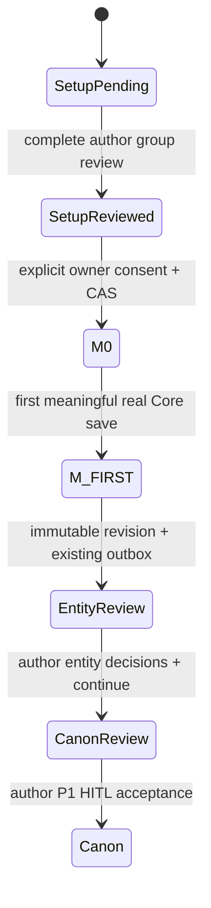

# setup-m0-v1 — approved setup activation and first save

Additive contract for Issue99, based on integration e7c7e078. Existing manuscript activation and P1 HITL contracts are unchanged.

`GET /api/v1/ai/story-brains/{novel}/setup/{snapshot}/activate` returns owner-scoped eligibility and current setup/review/Brain CAS tokens. `POST` to the same path requires:

```json
{"contract_version":"setup-m0-v1","idempotency_key":"stable-author-operation-key","setup_hash":"64-hex-source-hash","expected_setup_version":1,"expected_review_version":1,"expected_brain_version":2}
```

Gateway verifies authenticated active current owner, with no ADMIN delegation; Python verifies service credentials/identity/tenant, source author and current Platform ownership under a transaction. Snapshot IDs are UUIDs. Source/hash/latest version, full terminal supported-card review, actual proposal decisions and materialized approved artifacts must agree. At least one supported entity/rule must be accepted. Initial-condition cards are explicitly nonblocking only alongside a valid accepted supported artifact; they remain unresolved, never historical facts. Empty, rejected-only, initial-condition-only, failed, incomplete, stale and competing bootstrap sources fail closed.

Activation uses existing bootstrap advisory → Brain → current novel owner → source job → proposals/decisions → artifact locks. It atomically increments the new setup baseline Brain version, writes `setup_activation` audit/receipt in the existing immutable setup job envelope, completes that job, and sets Brain active with null baseline revision. It does not create a revision, outbox item, mention, state, event or analysis run. Exact key/body retry is a read-only receipt; changed key/body conflicts. Current ownership is rechecked even on replay. No provider/network call spans this transaction.

There is no schema migration or second store. A verified M0 is identified by active/null Brain plus the matching completed `setup-m0-v1` activation receipt/source/job/author/Brain/hash/version provenance. Legacy active/null without this provenance remains ineligible. A manuscript baseline requires a real matching immutable revision. No plan is required;0/5/20 chapter plans are separate FUTURE PLAN data.



M0 contains approved setup but zero real revisions/outbox/history. M-FIRST is a genuine content save under existing Core chapter-writer lease and Mongo CAS. Initial meaningful create and PATCH use the same immutable revision/outbox path; empty first creates do not fabricate history. Same content retries deduplicate, changed saves retain lineage, SQL/outbox failure can reconcile against the already saved Mongo draft. Create retry uses current durable draft content rather than overwriting an edited draft with old request text. AI draft acceptance still requires a real source revision and all existing P1 acceptance checks; activation does not manufacture a source revision.

Writer readiness is not Canon approval. Outbox COMPLETED means dispatch succeeded, not that entity review or Canon approval finished. All extracted events/facts remain in the existing P1 review path. User setup has no fake chapter occurrence, offset or chapter number. The mounted setup panel only adds explicit eligibility/activation feedback; broader Studio UI remains P2-05.
