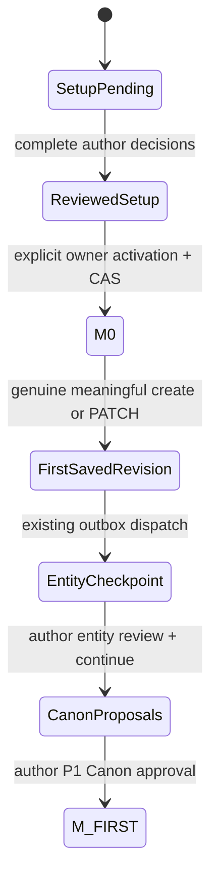

# P2-04 — Verified M0 and first genuine Core chapter

Issue: [99](https://github.com/Ephurin/Novel_sharing_platform/issues/99). Draft PR: [100](https://github.com/Ephurin/Novel_sharing_platform/pull/100), target `integration/p2-planning-studio`. No merge/deployment/live provider/P2-05 work.

## Source and scope

- Base, fetched before branch creation: `e7c7e078306408b28094334d89e32f1ba09e5c8f` (merged PR98).
- Branch: `codex/p2-04-first-chapter-bridge`, created from that remote HEAD in the clean existing worktree.
- Implementation source: `c5b54448f5ed8ed1d361082e7441359945dfc201`. Feature checkout `03af548ef14c29951facb37f7f966f41788f94b8`, identical source/checkout tree `fe36c157ba760f3c85cfa382742b89d968e23c76`. Delivery adds handoff/evidence only; its own exact SHA and independently rerun CI are recorded in PR metadata to avoid a self-referential commit hash.
- Read roadmap P2-04, gap audit G4/G5/authority, P2-02B/P2-03 handoffs, and workflow v1.4/narrative audit at immutable `7e1e8e96`.
- No database migration. Durable activation provenance/receipt uses the existing setup-v1 bootstrap job result; authoritative setup artifacts, Core revisions/outbox and Canon stores are reused.

## Additive API and authority

[setup-m0-v1 contract](P2_04_M0_CONTRACT.md) freezes GET readiness and POST explicit activation at `/api/v1/ai/story-brains/{novel}/setup/{snapshot}/activate` (Gateway), forwarded to `/v1/story-brains/...` (Python). Request contains typed contract version, stable idempotency key, setup hash and expected setup/review/Brain versions. It does not reinterpret legacy P1 activation input. Legacy `SETUP_ACTIVATION_NOT_AVAILABLE` remains intact for the old endpoint.

Gateway verifies JWT/active account/current owner even for ADMIN; trusted identity headers overwrite browser headers. Python independently checks service credentials, configured tenant, immutable setup source author, and current Platform owner under a shared row lock. Missing/foreign source is404, malformed input422, eligibility/CAS/replay conflicts409. No private notes/raw hints/outline are returned by activation/readiness. Generic setup job readback retains the existing public allowlist.

Activation revalidates latest source/hash, complete supported-card group membership, review/Brain CAS, every terminal proposal plus persisted decision/audit and actual confirmed artifact identity/type/value/subject. There must be at least one accepted supported entity/rule. Empty, all-rejected, unsupported-only, incomplete, failed, stale, altered artifact and competing bootstrap states fail closed. Initial conditions are nonblocking only alongside supported accepted artifacts, remain explicitly unresolved and are never materialized as history. Source chapter revisions/outbox/history/mentions/states/provenance must be absent.

Lock order: existing scoped bootstrap advisory → Brain → current novel owner → source job → proposals/decisions → artifacts. Eligibility, receipt/provenance, setup-specific Brain-version increment, active/null Brain and completed job commit together. Trigger-induced transaction failure proves no half-activation. Exact key/full-body replay is read-only even after subsequent real writing; changed key/body conflicts. Current ownership is checked before replay. This new setup transition increments Brain version; existing P1 activation semantics are unchanged. No provider call or Mongo request is inside activation transactions.

The receipt is trusted durable provenance written only by this checked transaction. Writer classifies active P1 using a real matching immutable baseline revision, or active chapterless M0 using the completed source job's matching typed activation/source/author/Brain/hash/version/artifact provenance. Active legacy/null or partial M0 markers cannot enable automatic snapshots. Explicit manuscript-bootstrap checkpoints protect every active Brain, independently of automatic Writer eligibility, including ADMIN. Ownership transfer does not implicitly adopt an old author's setup; handoff/recovery of an ineligible legacy state is conservatively blocked rather than silently repaired.

## M0 → M-FIRST through existing Writer



M0 has real approved setup and null baseline_revision_id, zero immutable chapter revisions/writer outbox/events/mentions/transitions. The legitimate setup analysis run already exists before activation; activation adds no analysis run. No chapter0/1, source revision or event is fabricated.

Core `createChapter` keeps its existing SQL import key/hash and novel-number serialization. Initial Mongo draft creation now occurs under the existing chapter-writer lease; first meaningful content then calls the same `snapshotSavedChapter` path as PATCH. It creates one genuine AUTHOR_MANUAL revision and deduplicated INCREMENTAL_ANALYSIS outbox in the existing SQL transaction. Empty/whitespace-only first content stays a draft. Metadata and Mongo CAS/lease behavior stay authoritative; same-body retries do not duplicate work, changed bodies retain real parent lineage. Create retry reads current durable draft content, preserving edits made after an earlier creation attempt. Mongo failure after SQL chapter creation and SQL/outbox failure after Mongo save are reconciled by the same client key/body retry, not a synthetic revision.

Real fake-provider writing generations use a genuine saved base revision. Existing acceptDraft still checks generation/source/actor/tenant/hash/Brain/patch/lease and stale source. Exact repeated acceptance of the same generation remains P1's idempotent200 receipt with no extra revision; a different stale generation is409. This preserves the pinned P1 contract rather than changing it to force a double-accept409. No artificial AI job is inserted for acceptance.

Existing outbox dispatch enters the existing P1 entity candidate checkpoint. Outbox COMPLETED proves dispatch, not Canon approval. Before author entity review/continue there are no approved events; resulting event/fact proposals remain pending until the author uses the existing group HITL endpoint. An actual active chapter8 Future Plan is tested alongside the first chapter; its planned betrayal never appears in confirmed events. The second novel exercises genuine create and AI acceptance with no plan.

## Mounted UI boundary

The existing AuthorMemoryPanel setup panel adds eligibility, explicit consent, actionable409/reload and truthful active/first-save feedback. No second editor/planner is introduced. GET readiness derives the first meaningful saved revision/hash/chapter number from real Core tables and never from a Plan target. Refresh cancels late replies and updates first-save state even when saving has not incremented Brain version. Account/novel switching clears state. Review completion alone is not labeled activation; the button performs the actual supported POST. Manual writing remains available and no Story Plan is required. Full Planning Studio remains P2-05.

Browser acceptance mounts the actual UI in Chromium with mocked HTTP, including real POST assertions/CAS/reload/readback/account changes; it is not browser-to-database E2E. Separate real authenticated Gateway→Python→PG/Mongo acceptance covers backend and Writer behavior. No live model/provider quality acceptance is claimed.

## Files changed

- Python `api/setup_schemas.py`, `api/narrative_routes.py`, `application/setup_service.py`, `infrastructure/setup_activation.py`: additive contract/principal/transaction/readback.
- Node `ai-gateway.controller.ts`, `ai-gateway.routes.ts`: owner-scoped routing; `chapter-revisions.service.ts`: verified baseline classification; `chapters.service.ts`: initial draft/first snapshot under lease.
- Web `setup-api.ts`, `SetupFoundationPanel.tsx`: scoped real activation/readiness in existing Author IDE.
- `test_setup_activation_postgres.py`, `m0-first-chapter.live.test.ts`, mounted setup browser tests, feature workflow: real acceptance/concurrency/failure evidence with fake providers, separate P1 entity-HITL process and private-log scans.
- This contract/handoff and `p2-04-evidence/`: exact-source artifacts/verifier; historical evidence is untouched.

## Reproducible commands and results

Feature CI applies existing backend migrations (`npm ci; npm run db:migrate`) and AI Alembic head, then runs the existing P2 selected SQL modules plus:

```text
pytest -o addopts= -vv -s -m postgres_integration --basetemp="$RUNNER_TEMP/p2-a16" --junitxml="$RUNNER_TEMP/p202/a16.xml" tests/test_p2_bootstrap_postgres.py tests/test_setup_v1_postgres.py tests/test_setup_author_scope_postgres.py tests/test_setup_review_postgres.py tests/test_plan_edit_postgres.py tests/test_plan_review_fixes_postgres.py tests/test_writing_plan_authority_postgres.py tests/test_setup_activation_postgres.py
P204_EVIDENCE_FILE="$RUNNER_TEMP/p202/m0-writer-readbacks.json" npx tsx --test src/modules/ai/m0-first-chapter.live.test.ts
node --test tests/setup-foundation.browser.test.mjs
python docs/development/p2/p2-04-evidence/verify.py <feature-artifact.zip>
```

The M0 Gateway test uses a separately restarted task AI service with `LLM_PROVIDER=fake`, `ENTITY_CANDIDATE_VERIFICATION_ENABLED=true`, `ENTITY_PIPELINE_VERSION=entity-human-review-v1`. Earlier P2/P1 legacy fake-provider regressions retain their original settings and are not relabeled human-HITL coverage. PostgreSQL/Mongo database identity guards require independent `p2a`; no P1 QA or shared production data is used.

P8 retains full PG (`pytest -o addopts= -q -m postgres_integration`), rollback, Core persistence, root P1/outline/controller gates and frontend/backend/mobile build/typechecks. P7 retains all required jobs. Counts below are only implementation source c5b54448; different SHAs are not pooled into one PASS.

| Exact source verification | Result | Exit |
| --- | --- | --- |
| [P2 Feature42488597839](https://github.com/Ephurin/Novel_sharing_platform/actions/runs/42488597839) |1/1 job PASS;139 SQL PASS including26 M0 cases;46 focused PASS|0|
| Real Gateway and Writer |19 forwarding PASS; existing P1 save/outbox and setup/plan Gateway tests PASS; new M0/Writer/HITL live test PASS|0|
| Mounted Chromium (HTTP mocked) |8 PASS,0 SKIP; screenshot visually inspected|0|
| [P742488597903](https://github.com/Ephurin/Novel_sharing_platform/actions/runs/42488597903) |3/3 jobs PASS; PG/vector/P1 HITL/root Compose preserved|0|
| [P842488597758](https://github.com/Ephurin/Novel_sharing_platform/actions/runs/42488597758) |7/7 jobs PASS; root P1 generate/accept/bootstrap/outline/controller gates preserved|0|
| Full PostgreSQL |337 PASS,8 SKIP,447 deselected|0|
| Full non-PostgreSQL |415 PASS,32 SKIP,345 deselected,6 subtests PASS|0|
| Build/typecheck/persistence/rollback |Web/backend/mobile, Core PG/Mongo persistence, existing migration0017 rollback/parity PASS|0|
| Offline archive verifier |25 full durable readbacks;7 genuine immutable revisions; M0/replay/real source spans/failure/CAS/privacy checks PASS|0|
| Live LLM / full browser→DB / local real DB |NOT_RUN; fake-only CI DB runtime and mocked-HTTP browser coverage explicitly separate|N/A|

Real CI services: PostgreSQL16.15 and Mongo7.0.45, disposable `p2a`. Two independent M0 activations have0 revisions/outbox/history/mentions/transitions/Mongo drafts and no plan, while approved entities/rules remain unchanged. First example M0/replay digest `e865c292fd2f1ad2084b103d54b7c73185fb16d68d600356ab25bd42a467d162`; second `2466410222ed24cb935e5be7494b65f95a1af998fe3a40f264478f85504afaec`. Optional0/5/20 objective cases are actual PostgreSQL tests. Four operational logs exclude private setup fields/markers; raw synthetic notes in test readbacks are deliberate security evidence, not app logs.

The verified first confirmed event quotes actual revision `83acbfd7-4d9b-466b-a153-3c8ec2ba5aa2`, chapter `60ff850b-a7b8-43ef-8380-a355d6688278`, source hash `6576f30caf49860b86840596c772631c4bff2f6f1697d44997fbc2ad820429b9`, codepoint span0:19, actual chapter1. The verifier recomputes the hash and exact source quote, not just a PASS label. No FutureOnlyBetrayal appears in history despite an actual active chapter8 plan.

See [artifact inventory, SHA256s and reproduction](p2-04-evidence/README.md), `source-ci.json`, and raw source/rollback zip archives. Backup/restore parity is unchanged, with pgvector0.8.7 and migration0017; no new migration is introduced.

## Historical failures and environment limits

- Initial source90c35725: [P2 run42486764135](https://github.com/Ephurin/Novel_sharing_platform/actions/runs/42486764135), job128750225482, and [P8 run42486764164](https://github.com/Ephurin/Novel_sharing_platform/actions/runs/42486764164), job128750225795, caught a real text/UUID SQL operator regression in Writer readiness. M0 PG tests passed but P1 save/create failed. Fixed explicit casts at4850e88e; no assertion/contract was weakened.
- Local unconfigured `npm test -- --test-name-pattern='snapshot|writer'` did not apply the intended filter through the package script, lacked required DB/Mongo/JWT configuration and exited1 (54 PASS/26 FAIL/4 SKIP). It is not database acceptance. Properly configured CI is authoritative; backend typecheck and Web build separately passed.
- Test-only Mongo collection metadata union typing failed local typecheck atf0db1b9e; narrowed the actual driver result at2f3cb36f and typecheck passed, without changing runtime assertions. Earlier sources that passed CI remain distinct historical evidence.
- Local mounted browser ran8 tests successfully at earlier8b0535d7 using Edge/Chromium and mocked HTTP; this is supplemental, not pooled into c5b54448 counts. PostgreSQL/Mongo acceptance is the real disposable CI environment; no local DB PASS is inferred. Live LLM, production deployment and external real-provider long runs are NOT_RUN by explicit scope, live calls=0.

## Final acceptance and review gate

Source runtime and offline artifact verification are complete and green. No known remaining implementation regression. Exact delivery-head CI is rerun after this evidence commit and recorded in PR100 metadata, separately from source CI. Draft PR100 stays unmerged; **READY_FOR_REVIEW**, subject to exact delivery CI and independent GPT-6 review. This is fake-provider functional acceptance, not a live-model or production-readiness claim.

Intentional boundaries: no ownership-transfer adoption/recovery of unverified legacy-null baselines; those fail closed. P1 exact-generation acceptance replay remains an idempotent receipt, while stale competing acceptance conflicts. Full browser→DB and live-provider/long-run quality acceptance are not claimed. Broad Planning Studio/P2-05, new Canon rules, quota/live forwarding, deploy and merge remain outside scope. Stop at independent review gate after delivery CI.
