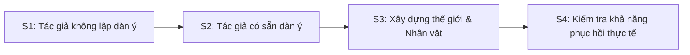
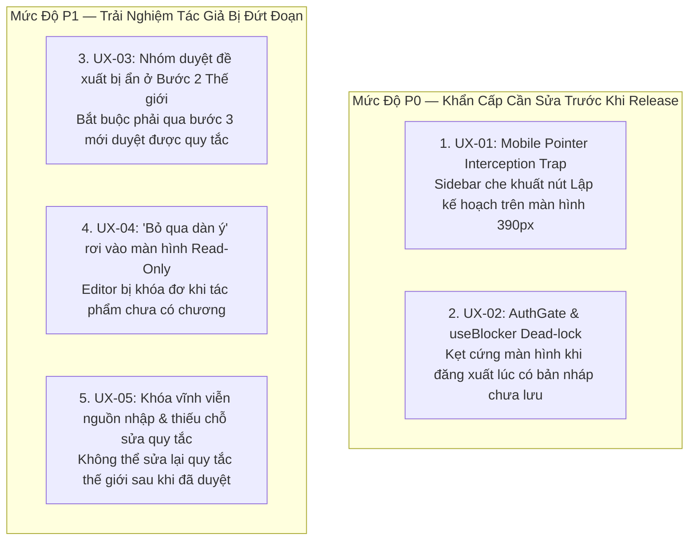

# Báo Cáo Kiểm Tra Trải Nghiệm Tác Giả (Author UX Audit) — Planning Studio

- **Mã báo cáo:** P2-07A
- **Người thực hiện:** QA Tester (Gemini Agent)
- **Kho lưu trữ:** `Ephurin/Novel_sharing_platform`
- **Nhánh kiểm thử:** `integration/p2-planning-studio`
- **Baseline Git SHA:** `5b105df364e3e594124961841914e00360096853` (Merge PR #102)
- **Môi trường kiểm thử:** Node.js v24.19.0, Vite Dev Server (port 5173), Playwright Chromium (Automated Headless & Viewport Emulation)
- **Tài liệu đối chiếu:**
  - [P2_STORY_PLANNING_STUDIO_ROADMAP.md](file:///c:/Users/thaib/Documents/Projects/Novel_sharing_platform/Novel_sharing_platform/docs/development/p2/P2_STORY_PLANNING_STUDIO_ROADMAP.md)
  - [P2_05_PLANNING_STUDIO_HANDOFF.md](file:///c:/Users/thaib/Documents/Projects/Novel_sharing_platform/Novel_sharing_platform/docs/development/p2/P2_05_PLANNING_STUDIO_HANDOFF.md)
  - [planning-studio.browser.test.mjs](file:///c:/Users/thaib/Documents/Projects/Novel_sharing_platform/Novel_sharing_platform/web/tests/planning-studio.browser.test.mjs)
  - [SKILL/FRONTEND_DESIGN.md](file:///c:/Users/thaib/Documents/Projects/Novel_sharing_platform/Novel_sharing_platform/.gemini/skills/frontend_design/SKILL.md) (StoryCraft Design System)

---

## 1. Tuyên Bố Phạm Vi & Phương Pháp Kiểm Thử

1. **Vai trò:** Báo cáo này được thực hiện độc lập dưới vai trò **QA Tester**, tuân thủ nguyên tắc không chỉnh sửa mã nguồn backend, database, không sửa hợp đồng API, và không tự ý sửa đổi code giao diện production.
2. **LLM Provider:** Trong suốt quá trình audit, **không có cuộc gọi LLM thực tế nào** được gửi tới Google Gemini hay bất kỳ nhà cung cấp trí tuệ nhân tạo bên ngoài nào (`dispatches = 0`). Tất cả phản hồi AI Copilot / Planning Studio đều chạy qua mock controller cô lập hoặc stub theo đúng hợp đồng thiết kế.
3. **Môi trường & Công cụ:** 
   - Kiểm thử thực tế qua Chromium Playwright với 2 cấu hình màn hình:
     - **Desktop:** 1280 × 800 (chuẩn tác giả làm việc trên máy tính)
     - **Mobile:** 390 × 844 (mô phỏng thiết bị di động, iPhone 12/13/14)
   - Lưu ý tính chất: Đây là bài kiểm tra tự động giao diện trình duyệt thực tế (Chromium Actual UI) kết hợp bộ mô phỏng máy chủ HTTP tại chỗ, không khẳng định là bài kiểm tra E2E kết nối cơ sở dữ liệu thật.

---

## 2. Kết Quả Kiểm Tra Chi Tiết 4 Hành Trình Tác Giả



---

### S1 — Tác Giả Không Lập Dàn Ý (Pantser / Discovery Writer)

#### Mục tiêu kiểm thử:
Xác nhận tác giả phong cách tự do ("pantser") có thể mở Author IDE, chỉ ghi chú một ý tưởng ngắn gọn, bỏ qua toàn bộ việc lập dàn ý và chuyển ngay sang viết chương 1 mà không bị hệ thống ép buộc phải tạo kế hoạch.

#### Các bước thực hiện & Quan sát:
1. **Truy cập:** Mở giao diện Author IDE với tác phẩm chưa có chương nào.
2. **Nhập ý tưởng ngắn:** Mở Planning Studio Bước 1 (`1. Ý tưởng`), nhập ý tưởng ngắn: *"Một kiếm sĩ trẻ phát hiện ra thanh tàn kiếm trong hang đá cổ..."*.
3. **Bỏ qua Story Plan:** Chuyển sang Bước 5 (`5. Bắt đầu viết`), quan sát các lựa chọn hiển thị.
4. **Xác nhận không bắt buộc dàn ý:** Hệ thống hiển thị rõ thông điệp:
   > *"Không bắt buộc có dàn ý. Mở chương có sẵn hoặc chủ động tạo một bản nháp trong trình soạn thảo hiện tại."*
   > *"Điều hướng không tạo chương, revision hay sự kiện. Bản nháp được lưu qua Writer hiện có; mọi diễn biến Canon vẫn cần bạn duyệt."*
5. **Chuyển sang viết:** Nhấn nút *"Bỏ qua dàn ý, mở trang viết"*.
6. **Vấn đề phát hiện:** Khi truyện chưa có chương nào, chuyển sang trang viết thì màn hình Writer rơi vào trạng thái `readOnly={true}` vì không có `activeChapterId`. Tác giả không thể gõ được nội dung và không có hướng dẫn nào nhắc nhở tạo chương (xem mã lỗi [UX-04](#ux-04-p1-bo-qua-dan-y-khi-chua-co-chuong-lam-tac-gia-roi-vao-trinh-soan-thao-bi-khoa-read-only-khong-co-huong-dan)).
7. **Khắc phục thao tác:** Tác giả phải tự bấm nút *"Tạo bản nháp chương mới"* tại Bước 5. Khi đó, một chương nháp *"Chương 1: Bản thảo mới"* được khởi tạo, giao diện Writer mở khóa và tác giả có thể soạn thảo bình thường.

#### Ảnh chụp bằng chứng:
- Bước 5 Bắt đầu viết: [`s1-step5-write.png`](file:///c:/Users/thaib/Documents/Projects/Novel_sharing_platform/Novel_sharing_platform/docs/development/p2/evidence/p2-07a/s1-step5-write.png)
- Màn hình Writer bị khóa khi bỏ qua dàn ý: [`s1-after-skip-empty-chapters.png`](file:///c:/Users/thaib/Documents/Projects/Novel_sharing_platform/Novel_sharing_platform/docs/development/p2/evidence/p2-07a/s1-after-skip-empty-chapters.png)
- Màn hình Writer sau khi tạo bản nháp chương thành công: [`s1-chapter-created.png`](file:///c:/Users/thaib/Documents/Projects/Novel_sharing_platform/Novel_sharing_platform/docs/development/p2/evidence/p2-07a/s1-chapter-created.png)

---

### S2 — Tác Giả Có Dàn Ý (Plotter / Outliner)

#### Mục tiêu kiểm thử:
Kiểm tra luồng tác giả đã có sẵn dàn ý dạng danh sách gạch đầu dòng, muốn dán vào hệ thống, tách thành các thẻ chương dự kiến, tùy biến mục tiêu, thêm sự kiện và kiểm tra tính bền vững của dữ liệu sau khi lưu và tải lại trang.

#### Các bước thực hiện & Quan sát:
1. **Dán dàn ý thô:** Tại Bước 4 (`4. Dàn ý chương`), nhập vào ô dàn ý văn bản 5 dòng:
   ```text
   Chương 1: Thức tỉnh trong thung lũng
   Chương 2: Tìm thấy thanh tàn kiếm
   Chương 3: Khởi hành đến An Thành
   Chương 4: Gặp gỡ thương đoàn bí ẩn
   Chương 5: Trận chiến đầu tiên
   ```
2. **Tách thành thẻ chương:** Nhấn nút *"Tách thành thẻ theo dòng"*. Hệ thống sinh chính xác 5 thẻ chương từ Thẻ 1 đến Thẻ 5.
3. **Chỉnh sửa mục tiêu & sự kiện:** 
   - Thay đổi mục tiêu Chương 1 thành: *"Nhân vật chính nhận thức được sức mạnh huyền bí của thanh kiếm"*.
   - Thêm sự kiện 1 cho Chương 1: *"Thanh kiếm phát sáng màu lam bảo vệ khỏi yêu thú"*.
   - Thêm người tham gia sự kiện.
4. **Lưu bản nháp dàn ý:** Bấm nút *"Lưu bản nháp dàn ý"*. Hệ thống ghi nhận phiên bản 1 (v1).
5. **Kiểm tra tính bền vững sau Reload:** Reload lại toàn bộ trang và mở lại Planning Studio:
   - Dữ liệu mục tiêu chương 1 được bảo toàn nguyên vẹn 100%: `"Nhân vật chính nhận thức được sức mạnh huyền bí của thanh kiếm"`.
6. **Vấn đề phát hiện:**
   - Khi di chuyển vị trí thẻ ("Xuống chương 1"), thẻ bị đổi vị trí trong danh sách nhưng số chương dự kiến không tự cập nhật, gây mâu thuẫn hiển thị (xem mã lỗi [UX-09](#ux-09-p2-khong-tu-dong-dong-bo-so-thu-tu-chuong-target_chapter-khi-di-chuyen-the)).
   - Nhãn của các trường sự kiện và người tham gia quá dài và lặp từ ngữ vi phạm tiêu chuẩn StoryCraft (xem mã lỗi [UX-07](#ux-07-p2-mat-do-hien-thi-kem-va-lap-nhan-qua-muc-tren-the-su-kien-dan-y)).

#### Ảnh chụp bằng chứng:
- Ô nhập dàn ý thô: [`s2-outline-input.png`](file:///c:/Users/thaib/Documents/Projects/Novel_sharing_platform/Novel_sharing_platform/docs/development/p2/evidence/p2-07a/s2-outline-input.png)
- 5 thẻ chương sau khi tách dòng: [`s2-after-split.png`](file:///c:/Users/thaib/Documents/Projects/Novel_sharing_platform/Novel_sharing_platform/docs/development/p2/evidence/p2-07a/s2-after-split.png)
- Bản nháp dàn ý đã lưu thành công v1: [`s2-plan-saved.png`](file:///c:/Users/thaib/Documents/Projects/Novel_sharing_platform/Novel_sharing_platform/docs/development/p2/evidence/p2-07a/s2-plan-saved.png)
- Dữ liệu hiển thị sau khi reload trang: [`s2-reloaded.png`](file:///c:/Users/thaib/Documents/Projects/Novel_sharing_platform/Novel_sharing_platform/docs/development/p2/evidence/p2-07a/s2-reloaded.png)

---

### S3 — Xây Dựng Thế Giới (World Building & Character Setup)

#### Mục tiêu kiểm thử:
Kiểm tra khả năng xử lý các tình huống phức tạp trong xây dựng thế giới: thêm hai nhân vật trùng tên ("Lý Thanh Vân"), thêm một quy tắc thế giới mới, kiểm tra quy trình duyệt (Review Decisions), và đánh giá liệu tác giả có hiểu rõ sự khác biệt giữa "Dữ liệu đề xuất" (Proposals) và "Dữ liệu đã chấp thuận" (Accepted Canon) hay không.

#### Các bước thực hiện & Quan sát:
1. **Thêm quy tắc thế giới:** Tại Bước 2 (`2. Thế giới`), nhập quy tắc: *"Nguyên tắc cấm kỵ: Không ai được rút kiếm sau hoàng hôn"*.
2. **Thêm nhân vật trùng tên:** Tại Bước 3 (`3. Nhân vật`), thêm 2 nhân vật:
   - Nhân vật 1: Tên *"Lý Thanh Vân"*, vai trò *"Nhân vật chính"*, ghi chú *"Đệ tử phái Thanh Vân"*.
   - Nhân vật 2: Tên *"Lý Thanh Vân"*, vai trò *"Phản diện ngầm"*, ghi chú *"Trưởng lão phản bội cùng tên họ"*.
3. **Xử lý thiết lập:** Bấm nút *"Lưu và xử lý thiết lập"*. Hệ thống sinh ra 6 đề xuất: 2 đề xuất nhân vật tác giả khai báo, 1 đề xuất quy tắc thế giới, và các đề xuất mở rộng từ phân tích.
4. **Quy trình Duyệt (Review Group):** 
   - Tác giả chọn *"Chấp nhận"* cho nhân vật chính Lý Thanh Vân và quy tắc thế giới.
   - Chọn *"Chỉnh sửa"* hoặc *"Bỏ qua"* cho các đề xuất không phù hợp.
   - Bấm *"Lưu quyết định duyệt"*, sau đó kích hoạt thiết lập với *"Kích hoạt thiết lập (M0)"*.
5. **Đánh giá nhận thức người dùng (Proposal vs Accepted):**
   - **Điểm tốt:** Hệ thống hiển thị các badge rõ ràng: *"Đề xuất chưa duyệt"*, *"Chấp nhận"*, *"Bỏ qua"*, *"Chỉnh sửa"*, và banner thông báo giải thích: *"Ý tưởng và dàn ý là dự định tương lai. Nhân vật và quy tắc chỉ trở thành thiết lập sau khi bạn duyệt. Diễn biến chương vẫn qua quy trình duyệt riêng."*
   - **Vấn đề phát hiện:**
     - Tại Bước 2 "Thế giới", giao diện ẩn hoàn toàn nhóm duyệt. Tác giả tạo quy tắc ở bước 2 nhưng bắt buộc phải chuyển sang bước 3 mới duyệt được quy tắc của mình (xem mã lỗi [UX-03](#ux-03-p1-an-hoan-toan-nhom-duyet-de-xuat-review-group-tai-buoc-the-gioi)).
     - Sau khi lưu nguồn, toàn bộ ô nhập bị khóa `disabled` vĩnh viễn và không có chức năng sửa quy tắc thế giới đã duyệt (xem mã lỗi [UX-05](#ux-05-p1-khoa-vinh-vien-nguon-nhap-thiet-lap-sau-khi-gui-duyet-va-khong-the-sua-quy-tac-da-duyet)).
     - Hai nhân vật trùng tên không có cảnh báo phân biệt (disambiguation) tại form nhập (xem mã lỗi [UX-10](#ux-10-p2-khong-co-canh-bao-phan-biet-khi-nhap-2-nhan-vat-trung-ten)).

#### Ảnh chụp bằng chứng:
- Giao diện bước 2 Thế giới: [`s3-world-step.png`](file:///c:/Users/thaib/Documents/Projects/Novel_sharing_platform/Novel_sharing_platform/docs/development/p2/evidence/p2-07a/s3-world-step.png)
- Nhập quy tắc thế giới: [`s3-rule-input.png`](file:///c:/Users/thaib/Documents/Projects/Novel_sharing_platform/Novel_sharing_platform/docs/development/p2/evidence/p2-07a/s3-rule-input.png)
- Nhập 2 nhân vật trùng tên: [`s3-characters-homonym.png`](file:///c:/Users/thaib/Documents/Projects/Novel_sharing_platform/Novel_sharing_platform/docs/development/p2/evidence/p2-07a/s3-characters-homonym.png)
- Thẻ đề xuất được sinh ra: [`s3-proposals-generated.png`](file:///c:/Users/thaib/Documents/Projects/Novel_sharing_platform/Novel_sharing_platform/docs/development/p2/evidence/p2-07a/s3-review-decisions.png)
- Quyết định duyệt đã lưu & Khóa nguồn: [`s3-after-decision-save.png`](file:///c:/Users/thaib/Documents/Projects/Novel_sharing_platform/Novel_sharing_platform/docs/development/p2/evidence/p2-07a/s3-after-decision-save.png)
- Nút kích hoạt M0 sẵn sàng: [`s3-m0-activated.png`](file:///c:/Users/thaib/Documents/Projects/Novel_sharing_platform/Novel_sharing_platform/docs/development/p2/evidence/p2-07a/s3-m0-activated.png)

---

### S4 — Trải Nghiệm Thực Tế & Khả Năng Phục Hồi (Real-world Resilience)

#### Mục tiêu kiểm thử:
Kiểm tra hành vi của hệ thống trong điều kiện thực tế khắc nghiệt: màn hình di động 390px, chuyển đổi qua lại giữa Planning và Writer, đăng xuất / đăng nhập lại, xung đột phiên bản API 409, mất kết nối mạng HTTP 503, và khả năng khôi phục bản nháp từ bộ nhớ cục bộ trên thiết bị (Local Device Draft Recovery).

#### Các bước thực hiện & Quan sát:
1. **Kiểm tra Responsive Mobile (390px):**
   - Thanh header IDE chiếm 56px, thanh điều hướng 5 bước chiếm 98px -> Tổng cộng 154px chiếm dụng cố định trên đỉnh màn hình (xem mã lỗi [UX-08](#ux-08-p2-thanh-dieu-huong-chiem-dung-qua-lon-dien-tich-tren-mobile)).
   - Chiều rộng không bị tràn ngang (`hasHorizontalScroll = false`).
2. **Lỗi nghiêm trọng trên Mobile — Pointer Interception Trap:**
   - Khi chuyển từ Planning sang Writer, Sidebar danh sách chương (`w-[280px] z-10`) tự mở che gần hết màn hình.
   - Tác giả cố gắng nhấn nút "Lập kế hoạch" ở header thì bị chặn hoàn toàn vì Sidebar `z-10` đè lên vùng click. Không thể chuyển lại Planning Studio (xem mã lỗi [UX-01](#ux-01-p0-mobile-navigation-trap--sidebar-de-len-thanh-chuyen-che-do-ide)).
3. **Chuyển qua lại Planning / Writer:**
   - Dữ liệu ghi chú riêng tư và bản nháp được bảo lưu an toàn khi chuyển đổi tab.
4. **Mô phỏng Xung đột Phiên bản (HTTP 409 Conflict):**
   - Giả lập xung đột CAS version khi lưu dàn ý. Hệ thống chặn ghi đè và giữ lại bản sửa của tác giả.
   - Vấn đề: Thông báo lỗi để lộ mã kỹ thuật `PLAN_VERSION_CONFLICT` (xem mã lỗi [UX-06](#ux-06-p2-lo-ma-loi-ky-thuat-truc-tiep-ra-giao-dien-khi-xung-dot-phien-ban-hoac-loi-mang)).
5. **Mô phỏng Mất kết nối Mạng (HTTP 503):**
   - Giả lập lỗi mạng khi tạo chương mới. Hệ thống hiển thị lỗi nhưng để lộ chuỗi raw: `NETWORK_FAILURE_503` (xem mã lỗi [UX-06](#ux-06-p2-lo-ma-loi-ky-thuat-truc-tiep-ra-giao-dien-khi-xung-dot-phien-ban-hoac-loi-mang)).
6. **Lỗi nghiêm trọng khi Đăng xuất — Deadlock AuthGate & useBlocker:**
   - Khi tác giả có một bản nháp chương đang viết dở (`dirty = true`) và đăng xuất hoặc hết phiên đăng nhập, `useBlocker` trong `useDraftPersistence` chặn React Router chuyển hướng sang `/login`.
   - Vì `AuthGate` render `<Navigate>` thay vì `children`, dialog cảnh báo giải phóng bản nháp không thể xuất hiện. Người dùng bị kẹt vô thời hạn tại trang IDE bị đơ (xem mã lỗi [UX-02](#ux-02-p0-dead-lock-dieu-huong-authgate-va-useblocker-khi-dang-xuat-luc-co-ban-nhap-chua-luu)).
7. **Khôi phục Bản nháp sau khi Đăng nhập lại:**
   - Sau khi đăng nhập lại, hệ thống nhận diện đúng bản sửa trên thiết bị và hiển thị banner màu cam: *"Có bản sửa dàn ý trên thiết bị. Bạn có thể khôi phục nội dung chưa lưu vào trình soạn thảo."* kèm nút *"Khôi phục bản sửa dàn ý"*.
   - Nhấn khôi phục, toàn bộ nội dung ghi chú và thẻ chương được nạp lại đầy đủ, không bị thất thoát chữ nào.

#### Ảnh chụp bằng chứng:
- Header Planning Studio trên Mobile 390px: [`s4-mobile-planning-header.png`](file:///c:/Users/thaib/Documents/Projects/Novel_sharing_platform/Novel_sharing_platform/docs/development/p2/evidence/p2-07a/s4-mobile-planning-header.png)
- Lỗi Sidebar che khuất nút chuyển chế độ trên Mobile: [`s4-switched-to-writer.png`](file:///c:/Users/thaib/Documents/Projects/Novel_sharing_platform/Novel_sharing_platform/docs/development/p2/evidence/p2-07a/s4-switched-to-writer.png)
- Bản ghi chú nháp trong Planning Studio: [`s4-mobile-dirty-note.png`](file:///c:/Users/thaib/Documents/Projects/Novel_sharing_platform/Novel_sharing_platform/docs/development/p2/evidence/p2-07a/s4-mobile-dirty-note.png)
- Thông báo lỗi xung đột phiên bản 409: [`s4-409-plan-conflict.png`](file:///c:/Users/thaib/Documents/Projects/Novel_sharing_platform/Novel_sharing_platform/docs/development/p2/evidence/p2-07a/s4-409-plan-conflict.png)
- Thông báo lỗi mạng 503: [`s4-503-create-error.png`](file:///c:/Users/thaib/Documents/Projects/Novel_sharing_platform/Novel_sharing_platform/docs/development/p2/evidence/p2-07a/s4-503-create-error.png)
- Màn hình đăng xuất: [`s4-logged-out.png`](file:///c:/Users/thaib/Documents/Projects/Novel_sharing_platform/Novel_sharing_platform/docs/development/p2/evidence/p2-07a/s4-logged-out.png)
- Khôi phục bản sửa trên thiết bị sau khi đăng nhập lại: [`s4-after-relogin.png`](file:///c:/Users/thaib/Documents/Projects/Novel_sharing_platform/Novel_sharing_platform/docs/development/p2/evidence/p2-07a/s4-after-relogin.png)

---

## 3. Bảng Tổng Hợp Lỗi Trải Nghiệm Tác Giả (UX Issues Catalog)

| Mã lỗi | Tiêu đề tóm tắt | Mức độ | Hành trình | Tác động chính |
| :--- | :--- | :---: | :---: | :--- |
| **UX-01** | Mobile Sidebar chặn sự kiện click vào nút chuyển chế độ IDE | **P0** | S4 | Không thể quay lại Planning Studio trên di động |
| **UX-02** | Dead-lock điều hướng AuthGate & useBlocker khi đăng xuất lúc có nháp chưa lưu | **P0** | S4 | Kẹt cứng màn hình IDE, không thể đăng xuất hoặc chuyển trang |
| **UX-03** | Ẩn hoàn toàn nhóm duyệt đề xuất (Review Group) tại bước 2 Thế giới | **P1** | S3 | Bắt buộc phải qua bước 3 mới duyệt được quy tắc thế giới |
| **UX-04** | "Bỏ qua dàn ý" khi chưa có chương đưa tác giả vào màn hình soạn thảo bị khóa không hướng dẫn | **P1** | S1 | Tác giả tưởng nhầm phần mềm bị treo |
| **UX-05** | Khóa vĩnh viễn nguồn nhập sau khi gửi duyệt; quy tắc đã duyệt không có chỗ sửa | **P1** | S3 | Không thể bổ sung thêm quy tắc/nhân vật trên Planning Studio |
| **UX-06** | Lộ mã lỗi kỹ thuật (`PLAN_VERSION_CONFLICT`, `NETWORK_FAILURE_503`) ra giao diện | **P2** | S4 | Gây hoang mang cho người dùng không am hiểu kỹ thuật |
| **UX-07** | Nhãn thẻ sự kiện lặp từ ngữ quá mức, vi phạm StoryCraft Content Density | **P2** | S2 | Tốn diện tích màn hình, ngắt dòng 3-4 hàng trên mobile |
| **UX-08** | Thanh điều hướng đỉnh màn hình chiếm 18% chiều cao trên Mobile (154px) | **P2** | S4 | Không gian hiển thị nội dung bị bóp nghẹt trên điện thoại |
| **UX-09** | Không tự động đồng bộ số thứ tự chương (`target_chapter`) khi di chuyển thẻ | **P2** | S2 | Gây nhầm lẫn giữa vị trí thẻ và số thứ tự chương thực tế |
| **UX-10** | Không có cảnh báo phân biệt (Disambiguation) khi nhập 2 nhân vật trùng tên | **P2** | S3 | Dễ gây nhầm lẫn thuộc tính và sự kiện giữa 2 nhân vật cùng tên |

---

## 4. Chi Tiết Từng Lỗi Phát Hiện

### UX-01 (P0): Mobile Navigation Trap — Sidebar đè lên thanh chuyển chế độ IDE
- **Vị trí tệp:** [`AuthorWritingIde.tsx`](file:///c:/Users/thaib/Documents/Projects/Novel_sharing_platform/Novel_sharing_platform/web/src/features/author-ide/AuthorWritingIde.tsx#L1000-L1010)
- **Mức độ:** **P0** (Showstopper trên Mobile)
- **Các bước tái hiện:**
  1. Mở Author IDE trên thiết bị di động (chiều rộng 390px).
  2. Tại header chế độ Author IDE, bấm *"Viết bản thảo"*.
  3. Thanh sidebar danh sách chương (`<aside class="sc-studio-sidebar w-[280px] z-10">`) tự động hiển thị chiếm 72% chiều ngang màn hình.
  4. Bấm vào nút *"Lập kế hoạch"* trên header để quay lại Planning Studio.
- **Kết quả mong đợi:** Nút *"Lập kế hoạch"* nhận được click và đưa người dùng trở lại màn hình Planning Studio, hoặc Sidebar tự động thu gọn khi người dùng click ra ngoài / chuyển chế độ.
- **Kết quả thực tế:**
  Playwright báo lỗi: `locator.click: Timeout 2000ms exceeded`:
  > `<aside class="sc-studio-sidebar ... z-10"> intercepts pointer events`
  Sidebar có z-index cao che phủ toàn bộ khu vực header chứa nút "Lập kế hoạch", khiến sự kiện click bị nuốt trọn. Tác giả bị nhốt vĩnh viễn ở chế độ Viết trừ khi phát hiện ra nút icon thu nhỏ `first_page`.
- **Bằng chứng:** [`s4-switched-to-writer.png`](file:///c:/Users/thaib/Documents/Projects/Novel_sharing_platform/Novel_sharing_platform/docs/development/p2/evidence/p2-07a/s4-switched-to-writer.png).

---

### UX-02 (P0): Dead-lock điều hướng AuthGate và useBlocker khi đăng xuất lúc có bản nháp chưa lưu
- **Vị trí tệp:** [`AuthGate.tsx`](file:///c:/Users/thaib/Documents/Projects/Novel_sharing_platform/Novel_sharing_platform/web/src/features/auth/AuthGate.tsx#L43-L45) và [`useDraftPersistence.ts`](file:///c:/Users/thaib/Documents/Projects/Novel_sharing_platform/Novel_sharing_platform/web/src/features/author-ide/useDraftPersistence.ts#L113-L115)
- **Mức độ:** **P0** (Lỗi luồng xác thực và điều hướng hệ thống)
- **Các bước tái hiện:**
  1. Tác giả đang mở một chương trong Author IDE và gõ nội dung nhưng chưa lưu xong (`dirty = true` trong `useDraftPersistence`).
  2. Phiên đăng nhập bị hủy hoặc tác giả bấm đăng xuất (`clearSession()` được gọi).
  3. `AuthGate` kiểm tra `!accessToken` và render `<Navigate to="/login" replace />`.
- **Kết quả mong đợi:**
  - Hệ thống phải hiển thị hộp thoại xác nhận: *"Bản nháp chưa lưu xong. Bạn muốn lưu và rời trang hay bỏ bản nháp để đăng xuất?"*.
  - Sau khi chọn, điều hướng sang `/login` phải thành công.
- **Kết quả thực tế:**
  - `useBlocker` trong React Router phát hiện `dirty = true` nên chặn hoàn toàn chuyển hướng sang `/login`.
  - Nhưng do `AuthGate` render `<Navigate>` thay vì `children`, component `AuthorWritingIde` bị unmount khỏi cây React. Hộp thoại modal `<AuthorDialog>` chứa các nút *"Lưu và rời trang"* / *"Rời trang"* không hề được render lên màn hình!
  - Ứng dụng rơi vào trạng thái dead-lock: URL giữ nguyên ở `/author/ide?...`, trang bị kẹt cứng, tác giả không thể thoát ra `/login` trừ khi đóng hẳn tab trình duyệt hoặc xóa sạch localStorage.
- **Bằng chứng:** `audit-summary.json`: `[AUDIT - S4] Phát hiện lỗi kẹt điều hướng AuthGate khi có bản nháp chưa lưu: {"isBlocked": true}`.

---

### UX-03 (P1): Ẩn hoàn toàn nhóm duyệt đề xuất (Review Group) tại bước 2 Thế giới
- **Vị trí tệp:** [`SetupFoundationPanel.tsx`](file:///c:/Users/thaib/Documents/Projects/Novel_sharing_platform/Novel_sharing_platform/web/src/features/ai-copilot/SetupFoundationPanel.tsx#L72-L73)
- **Mức độ:** **P1**
- **Các bước tái hiện:**
  1. Vào Bước 2 "Thế giới".
  2. Nhập một quy tắc thế giới mới vào ô nhập quy tắc.
  3. Bấm *"Lưu và xử lý thiết lập"*.
- **Kết quả mong đợi:** Danh sách đề xuất duyệt của quy tắc thế giới xuất hiện ngay tại Bước 2 để tác giả duyệt nhanh quy tắc vừa tạo.
- **Kết quả thực tế:**
  - Trong code: `<div hidden={!people}><SetupReviewGroup .../></div>` với điều kiện `people = planningStep === 'characters'`.
  - Nhóm duyệt bị ẩn hoàn toàn ở Bước 2. Tác giả chỉ thấy một câu chú thích nhỏ: *"Sau khi lưu, duyệt toàn nhóm ở bước Nhân vật, kể cả khi chỉ có quy tắc"*.
  - Với tác giả chỉ muốn xây dựng quy tắc thế giới trước mà chưa nghĩ ra nhân vật, luồng này gây khó hiểu tột độ vì họ phải chuyển sang bước khác không liên quan để phê duyệt quy tắc.
- **Bằng chứng:** [`s3-rule-input.png`](file:///c:/Users/thaib/Documents/Projects/Novel_sharing_platform/Novel_sharing_platform/docs/development/p2/evidence/p2-07a/s3-rule-input.png), [`s3-world-step.png`](file:///c:/Users/thaib/Documents/Projects/Novel_sharing_platform/Novel_sharing_platform/docs/development/p2/evidence/p2-07a/s3-world-step.png).

---

### UX-04 (P1): "Bỏ qua dàn ý" khi chưa có chương làm tác giả rơi vào trình soạn thảo bị khóa (Read-Only) không có hướng dẫn
- **Vị trí tệp:** [`AuthorWritingIde.tsx`](file:///c:/Users/thaib/Documents/Projects/Novel_sharing_platform/Novel_sharing_platform/web/src/features/author-ide/AuthorWritingIde.tsx#L1040-L1070)
- **Mức độ:** **P1**
- **Các bước tái hiện:**
  1. Mở một tác phẩm mới tinh chưa có chương nào.
  2. Vào Planning Studio -> Bước 5 *"Bắt đầu viết"*.
  3. Nhấn nút *"Bỏ qua dàn ý, mở trang viết"*.
- **Kết quả mong đợi:**
  - Trình soạn thảo hiển thị trạng thái Empty State rõ ràng: *"Chưa có chương nào được tạo. Nhấn 'Tạo chương 1' để bắt đầu viết."*
  - Hoặc tự động khởi tạo luôn một chương 1 nháp rỗng để tác giả bắt đầu gõ ngay.
- **Kết quả thực tế:**
  - Giao diện chuyển sang Writer nhưng URL không có `chapterId`.
  - Ô tiêu đề và textarea nội dung có thuộc tính `readOnly={true}`. Mọi thao tác gõ phím của tác giả bị nuốt chửng hoàn toàn mà không có bất kỳ âm thanh hay thông báo nào.
  - Tác giả cảm thấy phần mềm bị đơ/lỗi và không biết phải làm gì tiếp theo.
- **Bằng chứng:** [`s1-after-skip-empty-chapters.png`](file:///c:/Users/thaib/Documents/Projects/Novel_sharing_platform/Novel_sharing_platform/docs/development/p2/evidence/p2-07a/s1-after-skip-empty-chapters.png), `audit-summary.json`: `{"isReadOnly": true, "hasWarning": 2}`.

---

### UX-05 (P1): Khóa vĩnh viễn nguồn nhập thiết lập sau khi gửi duyệt và không thể sửa quy tắc đã duyệt
- **Vị trí tệp:** [`SetupFoundationPanel.tsx`](file:///c:/Users/thaib/Documents/Projects/Novel_sharing_platform/Novel_sharing_platform/web/src/features/ai-copilot/SetupFoundationPanel.tsx#L55-L65)
- **Mức độ:** **P1**
- **Các bước tái hiện:**
  1. Tại Bước 2 hoặc 3, sau khi tác giả nhấn *"Lưu và xử lý thiết lập"*.
  2. Đề xuất được sinh ra và `sourceLocked = !!snapshot?.proposals.length` có giá trị `true`.
- **Kết quả mong đợi:** Tác giả vẫn có thể chỉnh sửa nguồn hoặc thêm nhân vật/quy tắc mới bổ sung sau khi đã duyệt đợt đầu.
- **Kết quả thực tế:**
  - Tất cả các trường nhập liệu nguồn (Premise, World Rules, Characters) bị vô hiệu hóa `disabled` vĩnh viễn.
  - Hệ thống thông báo: *"Đã gửi nguồn để duyệt. Sửa nội dung trong nhóm duyệt bên dưới; dữ liệu đã chấp nhận chỉ đọc tại đây... Quy tắc đã duyệt chỉ đọc; màn hình này chưa hỗ trợ hiệu chỉnh quy tắc."*
  - Tác giả muốn sửa một quy tắc thế giới vừa duyệt xong thì hoàn toàn bất lực vì Planning Studio không cung cấp nút sửa quy tắc đã duyệt.
  - Hơn nữa, nếu có bản lưu dự phòng thiết lập trên máy (`local.backup`), toàn bộ các nút hành động bị disable âm thầm mà không có thông báo tại chỗ, buộc người dùng phải tự để ý banner trên cùng.
- **Bằng chứng:** [`s3-after-decision-save.png`](file:///c:/Users/thaib/Documents/Projects/Novel_sharing_platform/Novel_sharing_platform/docs/development/p2/evidence/p2-07a/s3-after-decision-save.png).

---

### UX-06 (P2): Lộ mã lỗi kỹ thuật trực tiếp ra giao diện khi xung đột phiên bản hoặc lỗi mạng
- **Vị trí tệp:** [`StoryPlanEditor.tsx`](file:///c:/Users/thaib/Documents/Projects/Novel_sharing_platform/Novel_sharing_platform/web/src/features/ai-copilot/StoryPlanEditor.tsx) và [`SetupFoundationPanel.tsx`](file:///c:/Users/thaib/Documents/Projects/Novel_sharing_platform/Novel_sharing_platform/web/src/features/ai-copilot/SetupFoundationPanel.tsx)
- **Mức độ:** **P2**
- **Các bước tái hiện:**
  1. Mở 2 tab cùng chỉnh sửa dàn ý, tab 1 lưu trước, tab 2 lưu sau (xung đột version CAS 409).
  2. Hoặc mất mạng khi bấm *"Tạo bản nháp chương mới"* (HTTP 503).
- **Kết quả mong đợi:** Hiển thị thông báo tiếng Việt tự nhiên và hướng dẫn cụ thể: *"Dàn ý đã được chỉnh sửa từ một phiên làm việc khác. Bản nháp trên máy của bạn vẫn an toàn; vui lòng làm mới để đối chiếu."* hoặc *"Không thể kết nối máy chủ. Vui lòng kiểm tra lại đường truyền internet."*
- **Kết quả thực tế:**
  - Banner hiển thị chuỗi kỹ thuật thô: `PLAN_VERSION_CONFLICT: PLAN_VERSION_CONFLICT. Bản sửa được giữ. Đọc máy chủ để đối chiếu; không tự ghi đè.`
  - Hoặc `Lỗi: NETWORK_FAILURE_503: NETWORK_FAILURE_503`.
- **Bằng chứng:** [`s4-409-plan-conflict.png`](file:///c:/Users/thaib/Documents/Projects/Novel_sharing_platform/Novel_sharing_platform/docs/development/p2/evidence/p2-07a/s4-409-plan-conflict.png), [`s4-503-create-error.png`](file:///c:/Users/thaib/Documents/Projects/Novel_sharing_platform/Novel_sharing_platform/docs/development/p2/evidence/p2-07a/s4-503-create-error.png).

---

### UX-07 (P2): Mật độ hiển thị kém và lặp nhãn quá mức trên thẻ sự kiện dàn ý
- **Vị trí tệp:** [`StoryPlanEditor.tsx`](file:///c:/Users/thaib/Documents/Projects/Novel_sharing_platform/Novel_sharing_platform/web/src/features/ai-copilot/StoryPlanEditor.tsx#L180-L240)
- **Mức độ:** **P2**
- **Các bước tái hiện:**
  1. Tại Bước 4 "Dàn ý chương", bấm *"Thêm sự kiện chương 1"*.
  2. Bấm tiếp *"Thêm người tham gia sự kiện 1 chương 1"*.
- **Kết quả mong đợi:** Tuân thủ tiêu chuẩn StoryCraft Design System (Content Density) bằng cách dùng ngữ cảnh phân cấp: Thẻ chương -> Danh sách sự kiện -> Người tham gia. Nhãn chỉ cần: *"Tên người tham gia"*, nút *"Xóa"*, *"Di chuyển"*.
- **Kết quả thực tế:**
  Giao diện render nhãn lặp lại toàn bộ chuỗi phân cấp dài dòng:
  - `Loại người tham gia 1 sự kiện 1 chương 1`
  - `Người tham gia 1 sự kiện 1 chương 1`
  - `Bỏ người tham gia 1 sự kiện 1 chương 1`
  - `Thêm người tham gia sự kiện 1 chương 1`
  Trên màn hình 390px, mỗi nhãn chiếm 3-4 dòng text, khiến nội dung chính bị đẩy ra ngoài vùng nhìn thấy.
- **Bằng chứng:** [`s2-after-split.png`](file:///c:/Users/thaib/Documents/Projects/Novel_sharing_platform/Novel_sharing_platform/docs/development/p2/evidence/p2-07a/s2-after-split.png).

---

### UX-08 (P2): Thanh điều hướng chiếm dụng quá lớn diện tích trên Mobile (154px)
- **Vị trí tệp:** [`PlanningStudio.tsx`](file:///c:/Users/thaib/Documents/Projects/Novel_sharing_platform/Novel_sharing_platform/web/src/features/ai-copilot/PlanningStudio.tsx#L40-L50)
- **Mức độ:** **P2**
- **Các bước tái hiện:**
  1. Mở Planning Studio trên màn hình di động (viewport 390 × 844).
- **Kết quả mong đợi:** Thanh điều hướng các bước (step navigation) tự động thu gọn thành thanh cuộn ngang (horizontal pill scroll) hoặc menu dropdown nhỏ gọn (< 44px).
- **Kết quả thực tế:**
  - Nhóm 5 nút bước (`1. Ý tưởng`, `2. Thế giới`, `3. Nhân vật`, `4. Dàn ý chương`, `5. Bắt đầu viết`) bị tràn và rớt dòng thành 2 hàng với chiều cao 98px.
  - Kết hợp với header của Author IDE (56px), tổng diện tích chiếm dụng cố định trên cùng là **154px** (~18.2% toàn bộ màn hình 844px). Khi người dùng bật bàn phím ảo, không gian còn lại cho form nhập gần như bằng không.
- **Bằng chứng:** [`s4-mobile-planning-header.png`](file:///c:/Users/thaib/Documents/Projects/Novel_sharing_platform/Novel_sharing_platform/docs/development/p2/evidence/p2-07a/s4-mobile-planning-header.png), `audit-summary.json`: `{"navHeight": 98, "ideHeaderHeight": 56, "totalOccupiedTop": 154}`.

---

### UX-09 (P2): Không tự động đồng bộ số thứ tự chương (`target_chapter`) khi di chuyển thẻ
- **Vị trí tệp:** [`StoryPlanEditor.tsx`](file:///c:/Users/thaib/Documents/Projects/Novel_sharing_platform/Novel_sharing_platform/web/src/features/ai-copilot/StoryPlanEditor.tsx#L120-L150)
- **Mức độ:** **P2**
- **Các bước tái hiện:**
  1. Có Thẻ 1 (Dự kiến chương 1) và Thẻ 2 (Dự kiến chương 2).
  2. Bấm nút *"Xuống chương 1"* tại Thẻ 1 để hoán đổi vị trí thẻ 1 xuống sau thẻ 2.
- **Kết quả mong đợi:**
  - Hoặc số chương dự kiến tự động đánh lại theo thứ tự trực quan: Thẻ nằm trên cùng là Chương 1, thẻ kế tiếp là Chương 2.
  - Hoặc có nút *"Đánh số lại theo thứ tự thẻ"*.
- **Kết quả thực tế:**
  Vị trí thẻ trong mảng thay đổi, nhưng trường nhập `target_chapter` giữ nguyên giá trị cũ. Kết quả hiển thị:
  - Thẻ 1 (nằm trên): `Thẻ 1 · Dự kiến chương 2`
  - Thẻ 2 (nằm dưới): `Thẻ 2 · Dự kiến chương 1`
  Điều này gây phản trực giác mạnh cho tác giả khi lên kế hoạch mạch truyện theo trình tự thời gian.
- **Bằng chứng:** [`s2-reloaded.png`](file:///c:/Users/thaib/Documents/Projects/Novel_sharing_platform/Novel_sharing_platform/docs/development/p2/evidence/p2-07a/s2-reloaded.png).

---

### UX-10 (P2): Không có cảnh báo phân biệt khi nhập 2 nhân vật trùng tên
- **Vị trí tệp:** [`SetupFoundationPanel.tsx`](file:///c:/Users/thaib/Documents/Projects/Novel_sharing_platform/Novel_sharing_platform/web/src/features/ai-copilot/SetupFoundationPanel.tsx#L140-L180)
- **Mức độ:** **P2**
- **Các bước tái hiện:**
  1. Tại Bước 3 "Nhân vật", tạo 2 thẻ nhân vật đều có tên là *"Lý Thanh Vân"* với vai trò và mô tả khác nhau (một chính diện, một phản diện ngầm).
- **Kết quả mong đợi:** Hệ thống hiển thị cảnh báo nhẹ (inline warning badge): *"Đã có nhân vật cùng tên 'Lý Thanh Vân'. Hãy bổ sung danh hiệu hoặc biệt danh để tránh nhầm lẫn khi phân tích ngữ cảnh cốt truyện."*
- **Kết quả thực tế:** Form cho phép nhập bình thường không có cảnh báo. Sau khi tạo đề xuất, 2 thẻ đề xuất cùng hiển thị tên *"Lý Thanh Vân"*, tác giả rất dễ chọn nhầm quyết định duyệt giữa 2 nhân vật này.
- **Bằng chứng:** [`s3-characters-homonym.png`](file:///c:/Users/thaib/Documents/Projects/Novel_sharing_platform/Novel_sharing_platform/docs/development/p2/evidence/p2-07a/s3-characters-homonym.png).

---

## 5. Top 5 Vấn Đề UX Quan Trọng Nhất Cần Ưu Tiên Xử Lý



1. **UX-01 (P0) — Mobile Pointer Interception Trap:** 
   Sidebar danh sách chương trên mobile đè lên header và chặn hoàn toàn sự kiện chạm vào nút *"Lập kế hoạch"*. Tác giả trên điện thoại không có đường quay lại Planning Studio. Cần thiết lập `z-index` phân tầng chuẩn và tự động thu gọn Sidebar khi người dùng chuyển tab hoặc bấm backdrop.
2. **UX-02 (P0) — Dead-lock điều hướng AuthGate & useBlocker:** 
   Khi có bản nháp chưa lưu, `useBlocker` chặn redirect tới `/login` nhưng `AuthGate` lại unmount component con khiến dialog giải phóng bản nháp không thể hiển thị. Cần cho phép `AuthGate` ưu tiên hiển thị dialog xác nhận hoặc bypass blocker khi hành động xuất phát từ đăng xuất có chủ đích.
3. **UX-03 (P1) — Ẩn nhóm duyệt đề xuất tại Bước 2 "Thế giới":** 
   Tác giả tạo quy tắc ở bước 2 nhưng nhóm duyệt lại bị ẩn cưỡng bức (`hidden={!people}`), buộc phải qua bước 3 mới duyệt được. Cần hiển thị `SetupReviewGroup` lọc riêng các đề xuất quy tắc thế giới ngay tại Bước 2.
4. **UX-04 (P1) — "Bỏ qua dàn ý" rơi vào Editor bị khóa Read-Only:** 
   Với truyện mới chưa có chương, nút "Bỏ qua dàn ý" đưa tác giả vào màn hình Writer bị khóa cứng mà không có Empty State hoặc nút tạo chương nhanh. Cần bổ sung Empty State hoặc tự động khởi tạo chương 1 nháp.
5. **UX-05 (P1) — Khóa vĩnh viễn nguồn nhập & không có chỗ sửa quy tắc thế giới đã duyệt:** 
   Sau khi gửi duyệt, toàn bộ ô nhập bị khóa `disabled`. Không có cơ chế thêm quy tắc thế giới mới hay sửa quy tắc đã duyệt tại Planning Studio. Cần cho phép mở khóa sửa nguồn hoặc bổ sung bảng quản lý quy tắc đã duyệt.

---

## 6. Đánh Giá Chung & Kết Luận (Verdict)

### Kết Luận: **`UX_FIX_REQUIRED`**

> [!WARNING]
> Planning Studio sở hữu nền tảng kiến trúc rất vững chắc: cơ chế lưu nháp ngoại tuyến (Device Backup), khả năng phân tách dàn ý tự động, kiểm soát phiên bản CAS và phân định rõ ràng giữa *"Ý định tương lai"* (Proposals) và *"Dữ liệu chính thức"* (Canon).
>
> Tuy nhiên, hệ thống **CHƯA ĐỦ ĐIỀU KIỆN ĐỂ PHÁT HÀNH TRẢI NGHIỆM (NOT READY FOR PRODUCTION RELEASE)** do tồn tại **2 lỗi P0 chặn đứng thao tác người dùng** (kẹt điều hướng trên Mobile do Sidebar đè pointer events và dead-lock trắng màn hình khi đăng xuất lúc có bản nháp chưa lưu), cùng với **3 lỗi P1 gây ức chế và đứt đoạn dòng chảy sáng tác** của tác giả.

### Bước Tiếp Theo:
1. Giữ nguyên trạng thái mã nguồn nhánh `integration/p2-planning-studio`, không tạo PR sửa đổi code production.
2. Lưu toàn bộ 22 ảnh chụp bằng chứng tại thư mục `docs/development/p2/evidence/p2-07a/`.
3. Bàn giao báo cáo này cho **GPT-6** thực hiện phản biện (Peer Review) và lên kế hoạch xử lý dứt điểm các lỗi P0/P1 trước khi gắn nhãn `UX_READY`.
