# CHƯƠNG 3. PHÂN TÍCH VÀ THIẾT KẾ HỆ THỐNG EPHURIN

> **Bản thảo báo cáo tốt nghiệp — mã nguồn sơ đồ Mermaid.**  
> Repository: Ephurin/Novel_sharing_platform · nhánh khảo sát: backup-remote-mixed · mốc khảo sát: cb5a950e82f89a906e15115dd65b80651ff131a6 · ngày đối chiếu: 18/11/2026.  
> Chương này được biên soạn theo cách tổ chức của báo cáo mẫu: kiến trúc → tác nhân/use case → kịch bản → lớp thực thể → cơ sở dữ liệu → biểu đồ tuần tự → kết luận.  
> **Quy ước tính xác thực:** [Đã đối chiếu mã nguồn] là chức năng/thiết kế có bằng chứng trong nhánh khảo sát; [Thiết kế định hướng] là kiến trúc hoặc chức năng được đặc tả trong tài liệu nhưng chưa được chứng minh triển khai đầy đủ trên nhánh này. Không được diễn giải thiết kế định hướng thành kết quả đã hoàn thành.

## 3.1. Kiến trúc tổng thể hệ thống

### 3.1.1. Phân rã các thành phần

Ephurin được xây dựng để phục vụ ba nhóm nghiệp vụ: đọc và tương tác với tiểu thuyết trực tuyến; sáng tác, quản lý và công bố tác phẩm; quản trị tài khoản và nội dung. Hệ thống có hai client chủ đạo: ứng dụng web React dành cho tác giả và quản trị viên, ứng dụng di động React Native/Expo dành cho độc giả. Hai client giao tiếp với backend Node.js/Express thông qua REST API. Backend được tổ chức theo **Modular Monolith**: các chức năng phân thành module nhưng dùng chung ứng dụng HTTP và hạ tầng dữ liệu.

Dịch vụ Python/FastAPI cho AI được lưu trữ trong cùng repository nhưng là thành phần độc lập. Ở mốc khảo sát, module Copilot của backend có tuyến yêu cầu sinh gợi ý sử dụng LLM adapter hoặc phản hồi giả lập; Python AI Service có các endpoint riêng để xử lý thực thể, sự kiện và ngữ cảnh. **Không suy diễn rằng mọi thao tác Copilot trên web đã đi qua Python AI Service.** Hướng tích hợp giữa hai thành phần được mô tả riêng khi phân tích thiết kế mở rộng.

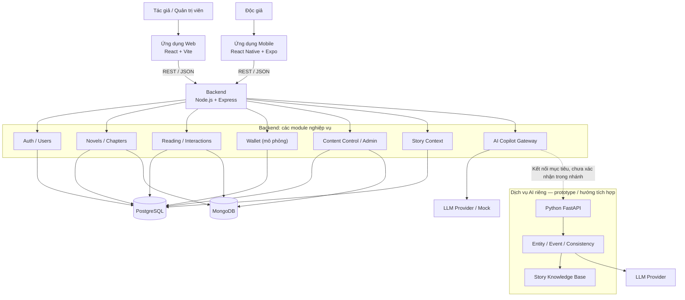

*Hình 3.1. Kiến trúc tổng thể và ranh giới các thành phần của Ephurin. Nét đứt biểu thị hướng tích hợp, không phải luồng đã xác nhận.*

Các trách nhiệm chính:

| Thành phần | Nhiệm vụ | Căn cứ |
|---|---|---|
| Web | Quản lý truyện, chương, bối cảnh tác phẩm, quản trị | Thư mục web/src/features |
| Mobile | Tìm kiếm, đọc, bình luận, thư viện và ví | Thư mục mobile/src/screens |
| Backend | Xác thực, phân quyền, xử lý nghiệp vụ, truy cập dữ liệu | backend/src/app.ts và backend/src/modules |
| PostgreSQL | Dữ liệu quan hệ: tài khoản, tác phẩm, chương, Coin, ngữ cảnh tác giả | backend/src/core/database/migrations |
| MongoDB | Bản thảo, bình luận, thông báo và bằng chứng kiểm duyệt | docs/Database/mongodb-collections.md |
| AI Copilot ở backend | Sinh gợi ý với dữ kiện nhân vật, timeline và văn bản gần đây | backend/src/modules/ai-copilot |
| AI Service Python | Các API trích xuất thực thể, đồng bộ KB, phân tích chương và gợi ý | ai-service/main.py và ai-service/api |
| Narrative Memory/Hybrid RAG | Định hướng cấu trúc tri thức và truy xuất ngữ cảnh chuyên sâu | docs/ARCHITECTURE.md, docs/DATA_MODEL.md; **thiết kế định hướng** |

### 3.1.2. Nguyên tắc kiến trúc

Backend được phân chia theo nghiệp vụ thay vì tách thành nhiều microservice triển khai độc lập. Nhóm module chính gồm: auth, users, novels, reading, interactions, wallet, content-control, admin, story-context và ai-copilot. Với các nghiệp vụ phù hợp, luồng xử lý gồm Route → Middleware → Controller → Service → Repository → Database. Quy tắc nghiệp vụ được đặt ở lớp service, trong khi repository chịu trách nhiệm truy cập dữ liệu.

Quyền tác giả và quyền quản trị phải được kiểm tra tại server. Một truy vấn dữ liệu hợp lệ về cú pháp vẫn không được phép sửa tác phẩm của người khác. Dữ liệu bản thảo đang chỉnh sửa được tách khỏi bản nội dung được công bố; hệ thống kiểm duyệt dựa trên quy tắc và quyết định của quản trị viên, không mặc định dùng mô hình ngôn ngữ để quyết định vi phạm.

## 3.2. Xây dựng biểu đồ Use Case và kịch bản

### 3.2.1. Xác định các tác nhân

Bốn nhóm người dùng được xác định như sau: **Guest** (khách chưa đăng nhập), **Reader** (độc giả), **Author** (tác giả) và **Admin** (quản trị viên). Trong phạm vi UML, Guest có thể xem những tài nguyên công khai, còn Reader/Author/Admin là vai trò tài khoản. AI Service và LLM Provider là **hệ thống liên kết**, không phải vai trò người dùng của nền tảng.

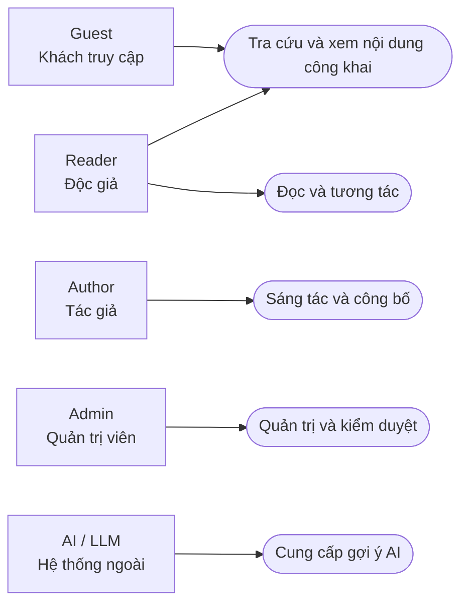

*Hình 3.2. Nhóm tác nhân và phạm vi nghiệp vụ. Biểu diễn Mermaid dùng để giới thiệu tác nhân, không thay thế ký pháp UML Use Case chuẩn.*

| Tác nhân | Mục đích | Giới hạn quyền |
|---|---|---|
| Guest | Khám phá truyện và chương công khai | Không thao tác trên dữ liệu cá nhân hoặc nội dung bị giới hạn |
| Reader | Đọc truyện, quản lý thư viện, bình luận, theo dõi và Coin | Không chỉnh sửa tác phẩm của tác giả |
| Author | Tạo và quản lý tác phẩm, bản thảo, ngữ cảnh; yêu cầu gợi ý AI | Phải sở hữu tác phẩm hoặc được phân quyền hợp lệ |
| Admin | Quản lý người dùng, danh mục, báo cáo và phiên kiểm duyệt | Chỉ thực hiện theo quyền quản trị; quyết định cần truy vết |
| AI/LLM (ngoài hệ thống) | Xử lý đề xuất văn bản hoặc phân tích nội dung theo yêu cầu | Không mặc định có quyền ghi trực tiếp dữ liệu truyện chính thức |

### 3.2.2. Danh sách ca sử dụng

Mô tả Use Case của chương dùng **Mermaid flowchart dạng nhóm chức năng** để hiển thị trực tiếp trên GitHub. Các hình này thể hiện tương quan tác nhân – chức năng nhưng **không phải mã UML Use Case chính thức**; khi nộp bản Word/PDF có thể chuyển sang PlantUML nếu khoa yêu cầu tuân thủ ký pháp UML chặt chẽ.

#### a) Use Case tổng quát

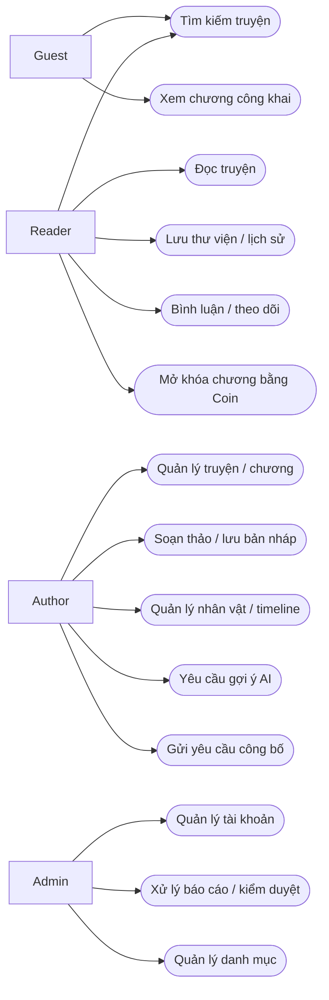

*Hình 3.3. Các nhóm Use Case của nền tảng Ephurin.*

#### b) Use Case dành cho độc giả

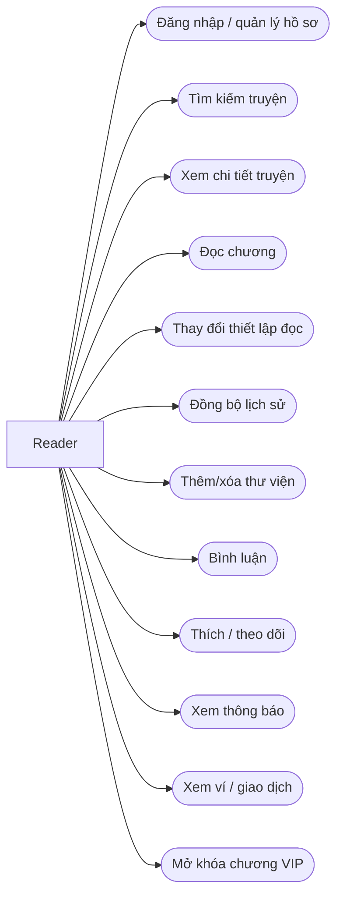

*Hình 3.4. Use Case chức năng của độc giả.*

Những chức năng như tìm kiếm và xem nội dung công khai có thể được cung cấp mà không cần đăng nhập tùy endpoint. Ngược lại, dữ liệu cá nhân, bình luận, đồng bộ lịch sử và mở khóa chương yêu cầu tài khoản hợp lệ. Giao dịch Coin là **mô phỏng**, không phải tích hợp thanh toán thực.

#### c) Use Case dành cho tác giả

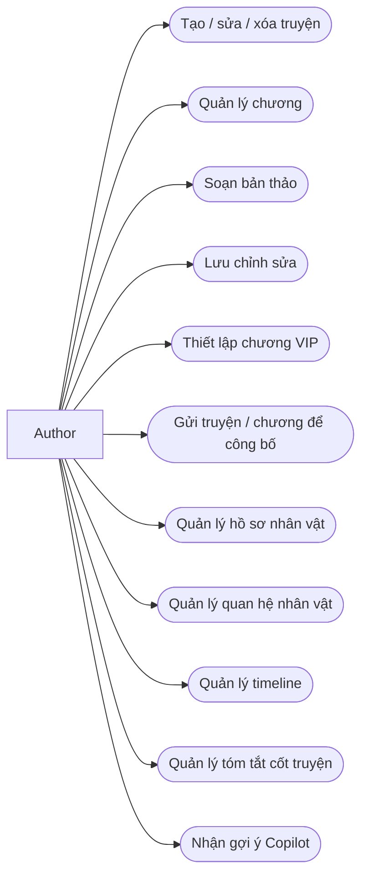

*Hình 3.5. Các chức năng sáng tác và quản lý tác phẩm của tác giả.*

#### d) Use Case hỗ trợ sáng tác bằng AI

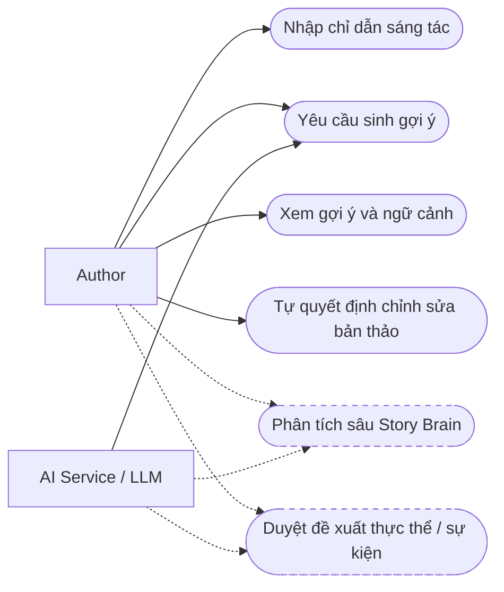

*Hình 3.6. Use Case AI Copilot. Nét đứt: quy trình Story Brain chuyên sâu thuộc thiết kế định hướng; gợi ý Copilot từ module backend đã có mã nguồn.*

Điểm cần phân biệt: endpoint backend hiện hành tạo gợi ý bằng LLM adapter hoặc mock, sử dụng các hồ sơ nhân vật, sự kiện timeline gần đây và đoạn văn ngắn gần nhất. Các thao tác import toàn bộ bản thảo, tạo Story Brain, phân tích delta theo revision, Hybrid Retrieval hay duyệt proposal như một hệ thống hợp nhất là thiết kế hướng phát triển được mô tả trong tài liệu chứ không được khẳng định hoàn chỉnh ở nhánh này.

#### e) Use Case dành cho quản trị viên

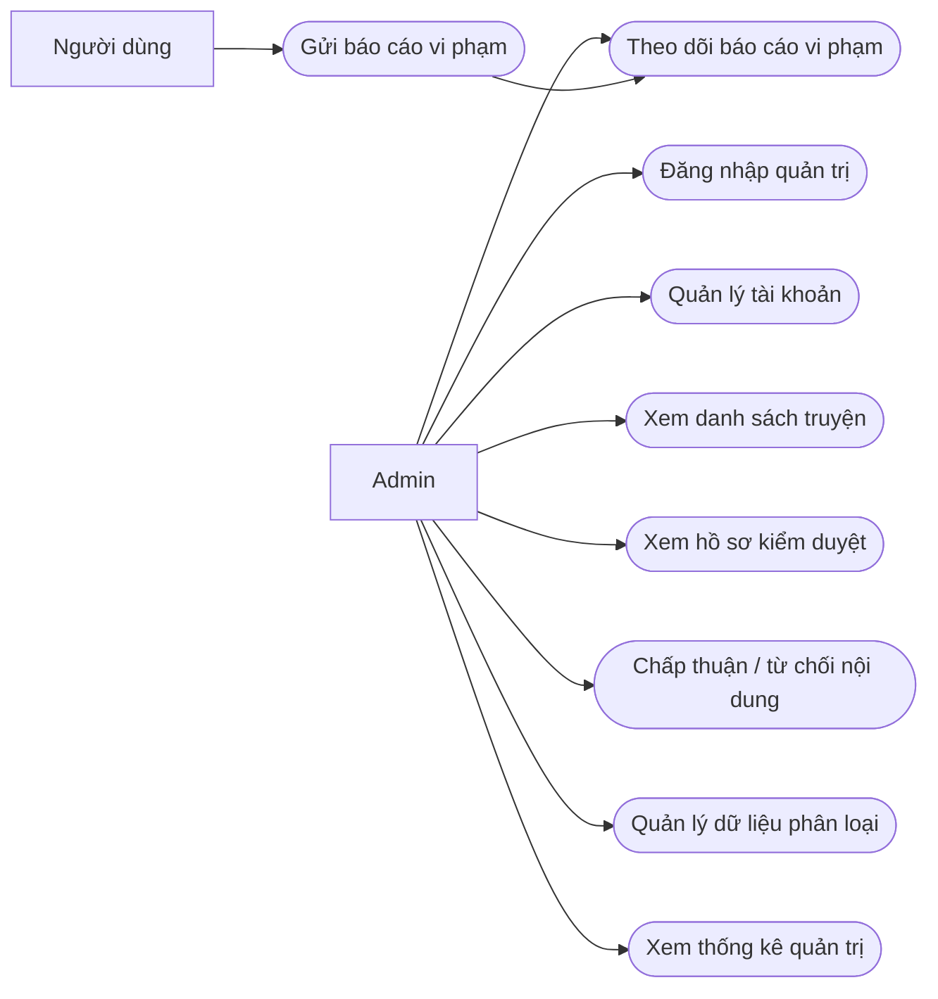

*Hình 3.7. Các chức năng của quản trị viên và quy trình báo cáo vi phạm.*

### 3.2.3. Kịch bản các Use Case tiêu biểu

Các bảng sau chọn những nghiệp vụ có giá trị phân tích và sẽ được mô tả tiếp bằng Sequence Diagram.

**Bảng 3.1. Kịch bản UC-01 — Đăng nhập**

| Thuộc tính | Mô tả |
|---|---|
| Tác nhân | Reader, Author hoặc Admin |
| Mục tiêu | Xác thực tài khoản và thiết lập phiên |
| Tiền điều kiện | Tài khoản tồn tại; người dùng có thông tin đăng nhập |
| Kích hoạt | Gửi biểu mẫu đăng nhập |
| Luồng chính | (1) Client gửi identifier/password. (2) Backend kiểm tra dữ liệu. (3) Auth Service truy vấn tài khoản. (4) Kiểm tra mật khẩu và trạng thái. (5) Tạo access JWT, refresh JWT; lưu hash refresh token. (6) Trả thông tin phiên và cookie phù hợp |
| Ngoại lệ | Thông tin không hợp lệ; tài khoản bị khóa; lỗi dữ liệu |
| Hậu điều kiện | Người dùng có phiên hợp lệ hoặc nhận thông báo lỗi |
| Căn cứ | backend/src/modules/auth/auth.routes.ts, auth.service.ts |

**Bảng 3.2. Kịch bản UC-02 — Tạo chương và lưu bản thảo**

| Thuộc tính | Mô tả |
|---|---|
| Tác nhân | Author |
| Mục tiêu | Tạo chương mới và lưu văn bản đang biên tập |
| Tiền điều kiện | Đã đăng nhập; sở hữu tác phẩm; truyện tồn tại |
| Luồng chính | (1) Tác giả chọn truyện. (2) Nhập tiêu đề, nội dung, tùy chọn VIP. (3) Backend kiểm tra quyền sở hữu và giá chương. (4) Ghi metadata chương vào PostgreSQL. (5) Lưu draft trong MongoDB. (6) Trả thông tin chương và phiên bản draft |
| Ngoại lệ | Không có quyền sở hữu; giá Coin không hợp lệ; lỗi lưu dữ liệu |
| Hậu điều kiện | Chương có metadata và bản draft tương ứng |
| Căn cứ | backend/src/modules/novels/chapters.service.ts, draft-chapters.repository.ts |

**Bảng 3.3. Kịch bản UC-03 — Gửi chương để công bố**

| Thuộc tính | Mô tả |
|---|---|
| Tác nhân | Author; Admin trong trường hợp cần xét duyệt |
| Mục tiêu | Đưa chương từ bản nháp sang trạng thái công khai hoặc chờ kiểm duyệt |
| Tiền điều kiện | Tác giả có quyền; trạng thái chương cho phép gửi; nội dung không rỗng |
| Luồng chính | (1) Gửi yêu cầu submit-publish. (2) Đọc draft hiện tại. (3) Kiểm tra bộ lọc từ khóa. (4a) Nếu PASS, cập nhật nội dung công bố và trạng thái PUBLISHED. (4b) Nếu cần duyệt, tạo hồ sơ và trạng thái PENDING_MODERATION |
| Ngoại lệ | Trạng thái không hợp lệ; bản thảo rỗng; không có quyền sở hữu |
| Hậu điều kiện | Chương được công bố hoặc ghi nhận chờ quản trị viên quyết định |
| Căn cứ | chapters.service.ts, content-control.service.ts |

**Bảng 3.4. Kịch bản UC-04 — Đọc và mở khóa chương VIP**

| Thuộc tính | Mô tả |
|---|---|
| Tác nhân | Reader |
| Mục tiêu | Xem chương đã có quyền truy cập hoặc mở khóa bằng Coin |
| Tiền điều kiện | Chương hợp lệ; để mở khóa cần đăng nhập |
| Luồng chính | (1) Reader mở chương. (2) Backend kiểm tra điều kiện hiển thị/quyền đọc. (3) Nếu bị khóa, Reader gửi yêu cầu mở khóa. (4) Wallet Service kiểm tra ví và bản ghi mở khóa. (5) Thực hiện thao tác giao dịch Coin theo quy tắc dữ liệu. (6) Trả kết quả mở khóa |
| Ngoại lệ | Thiếu Coin; đã mở khóa; chương không tồn tại; lỗi giao dịch |
| Hậu điều kiện | Quyền đọc chương được ghi nhận nếu giao dịch thành công |
| Phạm vi | Coin là mô phỏng; không khẳng định phát sinh thanh toán tiền thực |
| Căn cứ | reading.routes.ts, wallet.routes.ts, wallet.service.ts |

**Bảng 3.5. Kịch bản UC-05 — Sinh gợi ý AI Copilot**

| Thuộc tính | Mô tả |
|---|---|
| Tác nhân | Author |
| Mục tiêu | Nhận gợi ý viết dựa trên yêu cầu và một phần ngữ cảnh tác phẩm |
| Tiền điều kiện | Đăng nhập đúng vai trò; tác phẩm thuộc quyền sử dụng |
| Luồng chính | (1) Nhập chỉ dẫn và đoạn văn gần đây. (2) Backend xác thực quyền. (3) Truy vấn thông tin nhân vật và timeline. (4) Giới hạn văn bản gần nhất. (5) Chọn LLM adapter nếu cấu hình; nếu không, dùng phản hồi mock. (6) Trả gợi ý và metadata ngữ cảnh |
| Ngoại lệ | Không có quyền; chapter không thuộc novel; lỗi provider |
| Hậu điều kiện | Nhận văn bản gợi ý; không tự động ghi đè bản thảo |
| Căn cứ | backend/src/modules/ai-copilot/ai-copilot.service.ts |

**Bảng 3.6. Kịch bản UC-06 — Xử lý kiểm duyệt**

| Thuộc tính | Mô tả |
|---|---|
| Tác nhân | Admin |
| Mục tiêu | Xem bằng chứng, ra quyết định về nội dung bị đánh dấu |
| Tiền điều kiện | Có quyền ADMIN; tồn tại hồ sơ kiểm duyệt |
| Luồng chính | (1) Xem danh sách review. (2) Mở chi tiết và bằng chứng. (3) Ra quyết định. (4) Service kiểm tra trạng thái review. (5) Cập nhật review và nội dung liên quan. (6) Trả kết quả |
| Ngoại lệ | Review không tồn tại; đã xử lý; thiếu quyền |
| Hậu điều kiện | Có quyết định kiểm duyệt và trạng thái nội dung tương ứng |
| Căn cứ | content-control.routes.ts, content-control.service.ts |

### 3.2.4. Quy tắc nghiệp vụ cốt lõi

1. Người không sở hữu tác phẩm không được phép sửa truyện hoặc chương, trừ trường hợp được phân quyền quản trị.
2. Đăng nhập và quản lý phiên sử dụng JWT; refresh token được lưu dưới dạng hash ở cơ sở dữ liệu.
3. Chương VIP cần số Coin mở khóa lớn hơn 0; chương miễn phí có giá bằng 0.
4. Nội dung bản nháp và nội dung công bố được phân biệt về phạm vi sử dụng.
5. Kiểm duyệt nội dung thuộc content-control, không coi kết quả sinh văn bản của AI là quyết định kiểm duyệt.
6. Tác giả giữ quyền quyết định có dùng văn bản AI gợi ý hay không.
7. Giao dịch ví phải duy trì các điều kiện toàn vẹn dữ liệu; dịch vụ Coin chỉ là mô phỏng nghiệp vụ.

## 3.3. Xây dựng biểu đồ lớp thực thể

### 3.3.1. Nguyên tắc xây dựng

Các biểu đồ lớp trong phần này là **mô hình lớp thực thể nghiệp vụ (conceptual domain model)** rút ra từ bảng/collection và API; chúng không có nghĩa mọi thực thể đã được định nghĩa thành class TypeScript tương ứng. Các thuộc tính được chọn theo vai trò thiết kế, lược bỏ một số thuộc tính kiểm toán để sơ đồ có thể đọc được trên trang báo cáo.

### 3.3.2. Nhóm tài khoản, tác phẩm, chương và ngữ cảnh

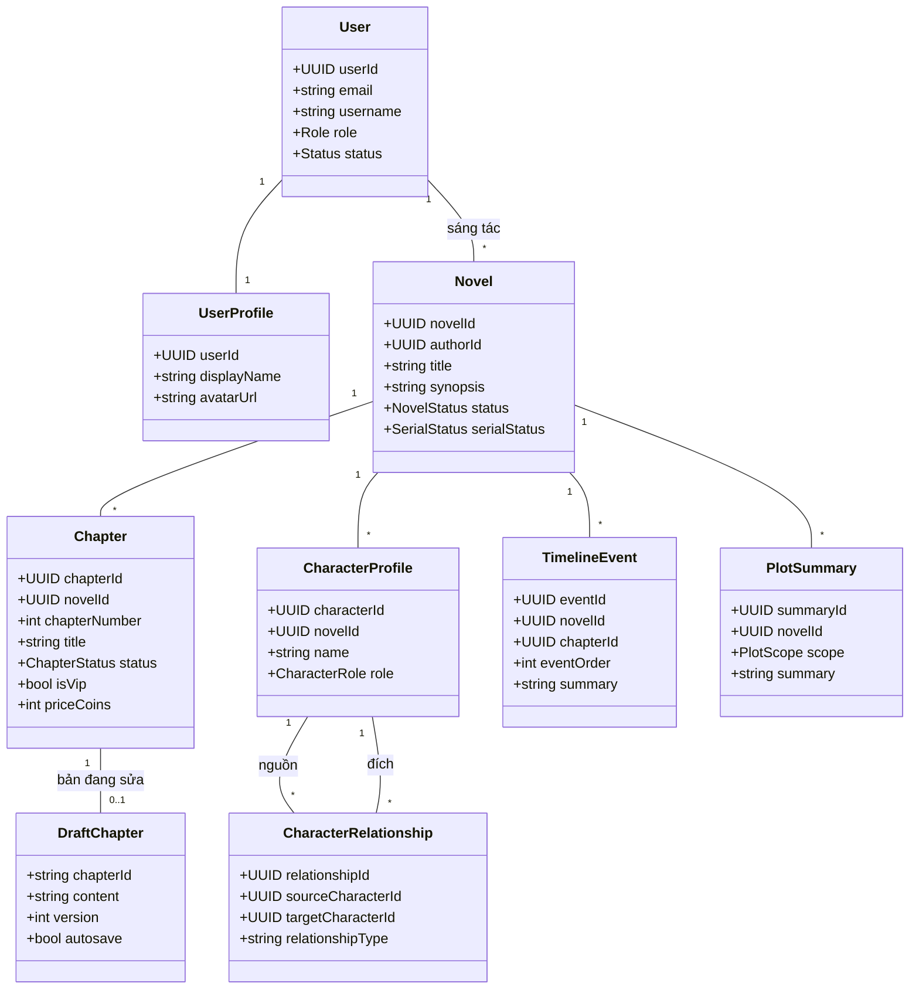

*Hình 3.8. Biểu đồ lớp thực thể của tác giả, truyện, chương và ngữ cảnh.*

Quan hệ User–Novel là một–nhiều; Novel–Chapter là một–nhiều. Một chương có thể có một bản draft hoạt động trong MongoDB theo thiết kế hiện tại. Các đối tượng CharacterProfile, CharacterRelationship, TimelineEvent và PlotSummary lưu thông tin chính thức do tác giả quản lý, được cụ thể hóa bởi migration 008_authoring_context.sql. Không đồng nhất các bảng này với mô hình Story Brain mở rộng của AI Service.

### 3.3.3. Nhóm đọc truyện, tương tác và Coin

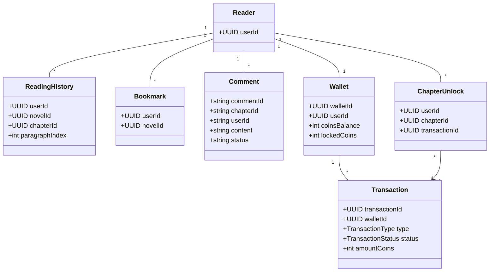

*Hình 3.9. Mô hình lớp thực thể của đọc truyện, tương tác và giao dịch mô phỏng.*

ReadingHistory và Bookmark là dữ liệu quan hệ PostgreSQL; Comment được biểu diễn trong MongoDB. Việc dùng liên kết ở biểu đồ lớp có ý nghĩa nghiệp vụ, không hàm ý tồn tại khóa ngoại xuyên hai hệ quản trị dữ liệu.

### 3.3.4. Mô hình lớp logic cho AI Copilot

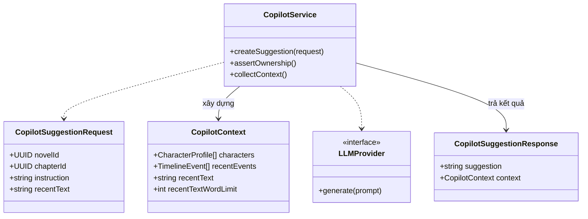

*Hình 3.10. Mô hình lớp logic phục vụ ca sử dụng sinh gợi ý Copilot ở backend.*

Các lớp ở Hình 3.10 là cách trừu tượng hóa cấu trúc request, context và service; không khẳng định mã nguồn có chính xác các khai báo class như hình. Ở nhánh khảo sát, service chọn provider dựa trên cấu hình, có phương án mock để duy trì luồng phản hồi khi không cấu hình LLM.

## 3.4. Thiết kế cơ sở dữ liệu

### 3.4.1. Phân chia trách nhiệm lưu trữ

Hệ thống sử dụng PostgreSQL cho thông tin tài khoản, truyện, chương, ngữ cảnh chính thức, lịch sử đọc, quan hệ tương tác và giao dịch Coin. MongoDB phù hợp với bản thảo hoạt động, bình luận, thông báo và một số bằng chứng/nhật ký.

| Nhóm dữ liệu | Kho lưu trữ | Lý do |
|---|---|---|
| User, refresh token, novel, chapter | PostgreSQL | Ràng buộc khóa và trạng thái nghiệp vụ |
| Reading history, bookmark, like, follow | PostgreSQL | Quan hệ người dùng–truyện–chương |
| Wallet, transaction, unlock | PostgreSQL | Giao dịch và kiểm tra số dư |
| Character, relationship, timeline, plot summary | PostgreSQL | Ngữ cảnh tác giả đã xác nhận |
| Draft chapter, comment, notification | MongoDB | Dữ liệu document và cập nhật theo nội dung |
| AI Story Brain, fact, event, state, semantic memory | Chưa coi là lược đồ triển khai trong nhánh | Thuộc đặc tả AI mở rộng, không đưa vào ERD thực thi |

### 3.4.2. ERD nhóm tài khoản, truyện và trải nghiệm đọc

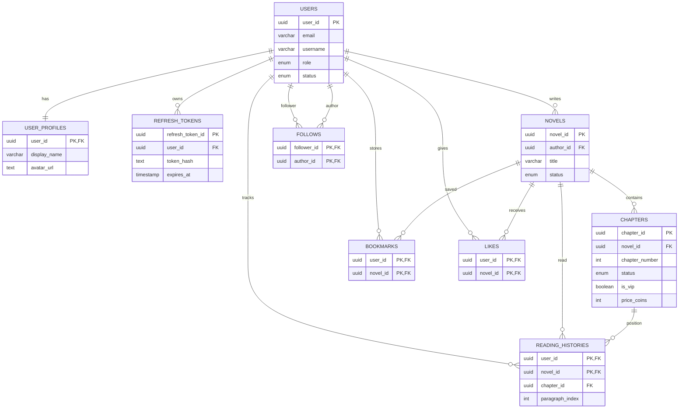

*Hình 3.11. ERD rút gọn cho dữ liệu tài khoản, truyện và đọc truyện.*

Các quan hệ nhiều–nhiều được chuẩn hóa bằng bảng liên kết. Ví dụ BOOKMARKS liên kết user và novel; FOLLOWS liên kết người theo dõi với tác giả được theo dõi, đồng thời có ràng buộc không được tự theo dõi chính mình. Hình lược bớt một số cột và bảng danh mục để phù hợp dung lượng trang; lược đồ đầy đủ được định nghĩa trong các migration SQL.

### 3.4.3. ERD nhóm Coin và kiểm duyệt

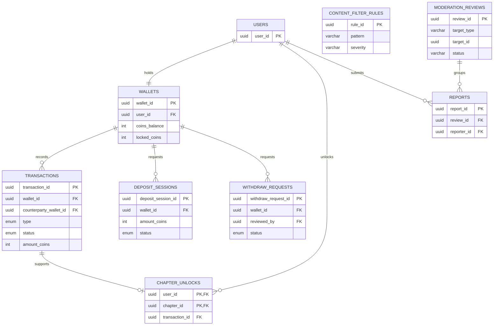

*Hình 3.12. ERD nghiệp vụ Coin mô phỏng và quản lý báo cáo nội dung.*

Trong Hình 3.12, phần Coin và kiểm duyệt là hai cụm bảng nghiệp vụ; chúng không được biểu diễn có quan hệ trực tiếp chỉ để tạo một ERD liên thông. Các trường minh họa của CONTENT_FILTER_RULES và MODERATION_REVIEWS cần đối chiếu DDL khi xuất bản ERD đầy đủ; hình này chủ yếu biểu diễn trách nhiệm và quan hệ cốt lõi. Việc dùng khóa tham chiếu đến tài nguyên kiểm duyệt theo loại và ID không đồng nghĩa luôn tồn tại khóa ngoại SQL đến mọi bảng nội dung.

### 3.4.4. ERD dữ liệu ngữ cảnh tác giả

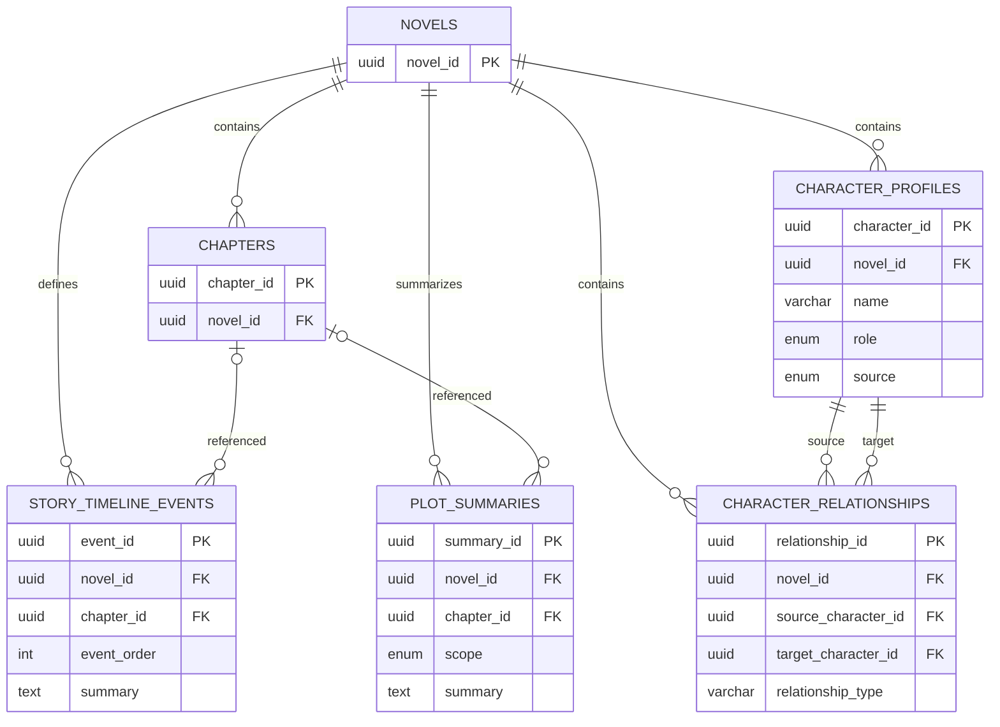

*Hình 3.13. ERD ngữ cảnh chính thức của tác giả được đối chiếu với migration 008_authoring_context.sql.*

**Lưu ý về dữ liệu nguồn:** Các trường source_proposal_id trong bảng ngữ cảnh là vị trí phục vụ khả năng tích hợp Copilot, không đủ bằng chứng để khẳng định cả chu trình duyệt proposal AI đã triển khai trên nhánh. Trong DDL tại mốc khảo sát, đây không phải khóa ngoại đã tạo đến một bảng proposal hiện hữu.

### 3.4.5. Mô hình dữ liệu MongoDB

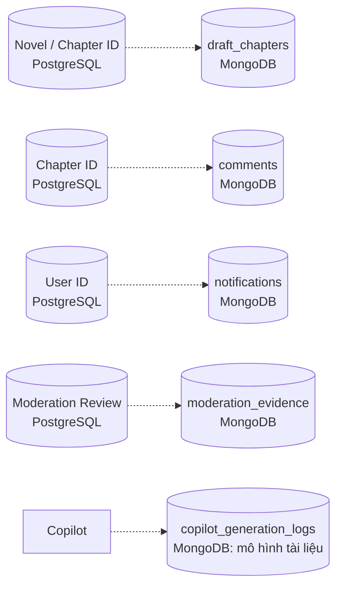

*Hình 3.14. Phân chia dữ liệu dạng document và các định danh tham chiếu logic.*

Các đường nét đứt biểu thị **tham chiếu bằng định danh ở tầng ứng dụng**, không phải khóa ngoại giữa PostgreSQL và MongoDB. Mô hình dựa trên docs/Database/mongodb-collections.md. Cần tách các collection đã được module nghiệp vụ sử dụng khỏi các collection mới ở mức thiết kế tài liệu khi thống kê kết quả triển khai ở Chương 4.

## 3.5. Sơ đồ tuần tự một số chức năng chính

### 3.5.1. Đăng nhập

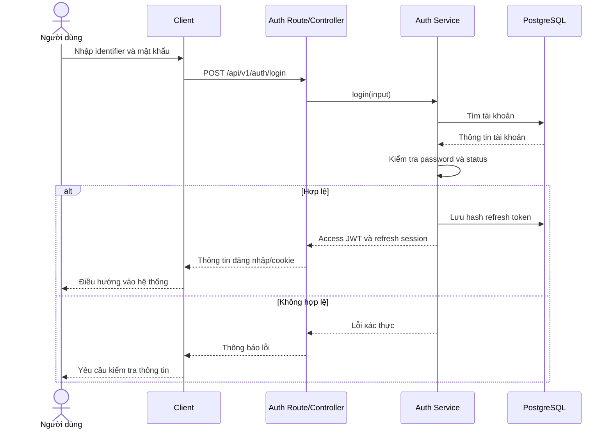

*Hình 3.15. Sequence Diagram đăng nhập, dựa trên Auth Service và các route hiện có.*

### 3.5.2. Lưu bản thảo và công bố chương

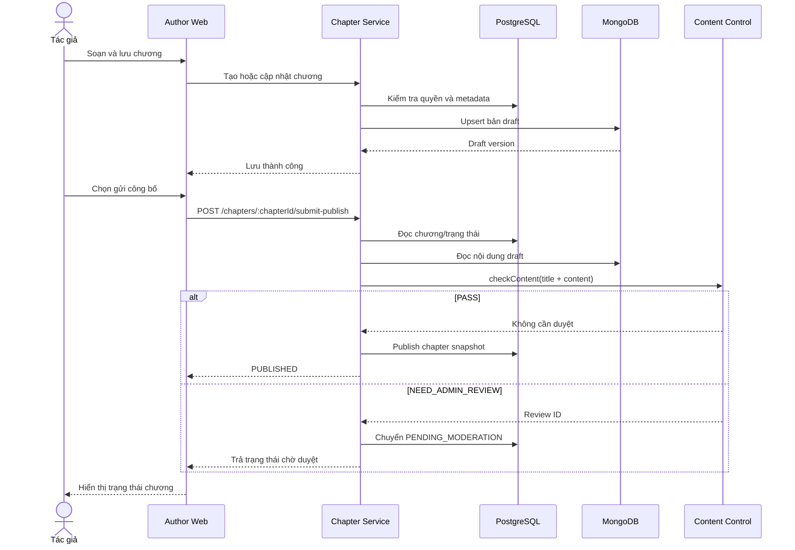

*Hình 3.16. Sequence Diagram lưu và gửi công bố chương; nhánh kiểm duyệt dựa trên rule filtering.*

### 3.5.3. Mở khóa chương bằng Coin

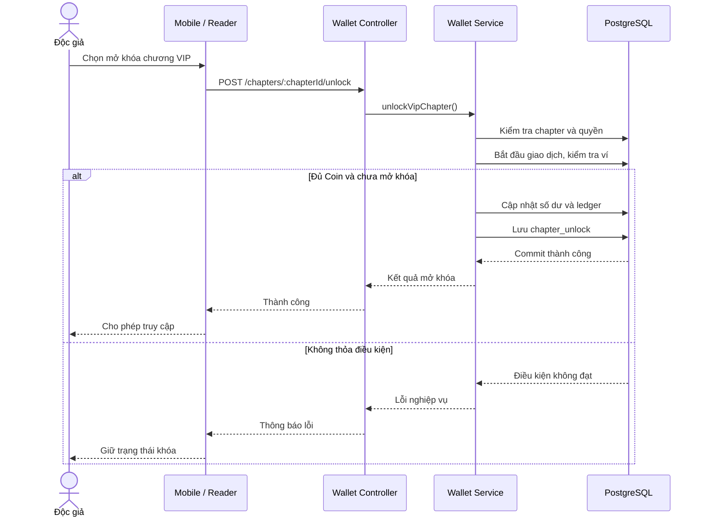

*Hình 3.17. Sequence Diagram mở khóa chương theo giao dịch Coin mô phỏng.*

### 3.5.4. Sinh gợi ý Copilot theo triển khai backend hiện hành

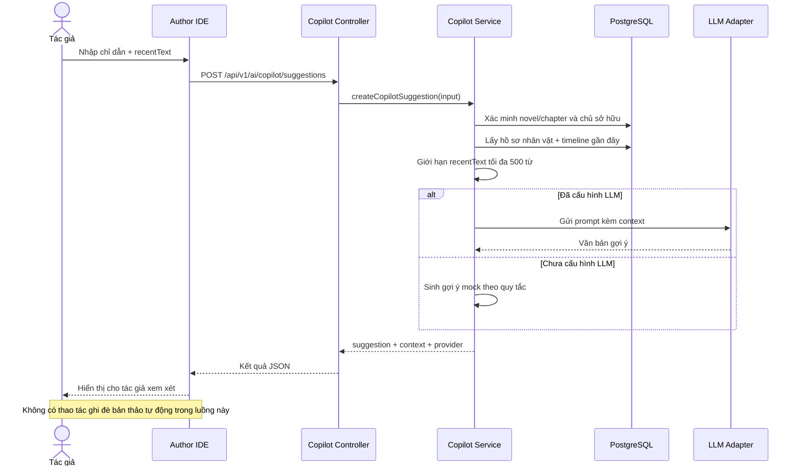

*Hình 3.18. Sequence Diagram Copilot từ mã nguồn backend. Không gộp nhầm với API FastAPI riêng.*

### 3.5.5. Quản trị kiểm duyệt nội dung

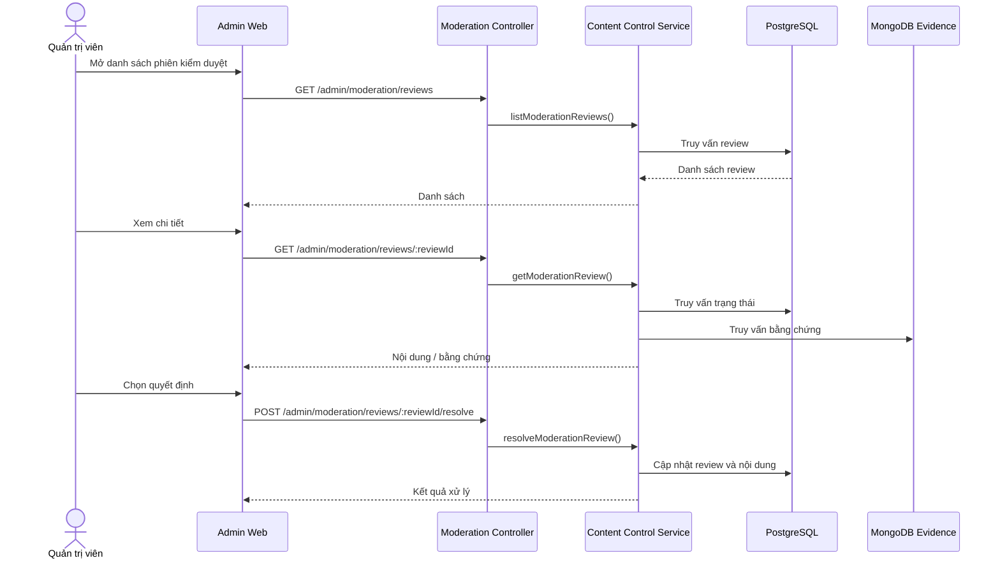

*Hình 3.19. Sequence Diagram quy trình quyết định kiểm duyệt; quản trị viên là tác nhân quyết định cuối.*

## 3.6. Thiết kế quy trình AI và mô hình trạng thái

### 3.6.1. Quy trình AI Service độc lập ở mốc khảo sát

Python AI Service cung cấp các thành phần trích xuất thực thể, quản lý Knowledge Base và kiểm tra thông tin. Các thao tác có thể tạo ứng viên thực thể, phân tích ngữ cảnh hoặc gợi ý nội dung. Việc gọi LLM không đồng nghĩa dữ liệu tự động trở thành dữ kiện đã được tác giả phê duyệt.

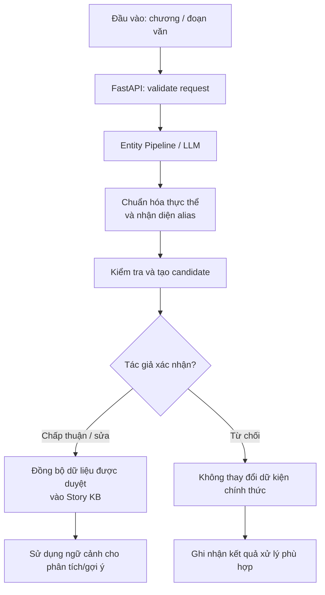

*Hình 3.20. Activity Diagram định hướng kiểm soát dữ kiện qua Human-in-the-Loop, dựa trên luồng AI Service/KB của nhánh.*

Đây là hình thể hiện nguyên tắc thiết kế và các bước nghiệp vụ, không chứng minh tự động hóa toàn bộ vòng lặp tác giả duyệt trong một màn hình đã hoạt động end-to-end.

### 3.6.2. Kiến trúc Story Brain và truy xuất ngữ cảnh dài — thiết kế định hướng

Tài liệu docs/PRODUCT.md, docs/USE_CASES.md, docs/DATA_MODEL.md và docs/ARCHITECTURE.md mô tả hệ thống Story Brain theo các lớp: dữ kiện được tác giả xác nhận (canonical), dữ liệu dẫn xuất có thể tái tạo (derived) và đề xuất chưa được phê duyệt (proposed). Dự định sử dụng sự kiện lịch sử, trạng thái hiện tại và quan hệ để tạo ngữ cảnh có cấu trúc, hạn chế nhồi toàn bộ tiểu thuyết vào prompt. Đây là **thiết kế định hướng**, không đồng nhất với hệ CSDL đã chạy trên nhánh backup-remote-mixed.

```mermaid
flowchart TD
    Input["Yêu cầu viết / phân tích"] --> Scope["Xác định novel, chapter, phạm vi thời gian"]
    Scope --> Q1["Truy xuất dữ kiện canonical"]
    Scope --> Q2["Truy xuất sự kiện và trạng thái"]
    Scope -.-> Q3["Semantic / hybrid retrieval<br/>(giai đoạn định hướng)"]
    Q1 --> Pack["Context Builder / Budget Packer"]
    Q2 --> Pack
    Q3 -.-> Pack
    Pack --> LLM["LLM tạo gợi ý / nhận xét"]
    LLM --> Check["Kiểm tra schema và tính nhất quán"]
    Check --> Review["Tác giả preview và quyết định"]
    Review -->|Chấp thuận| Persist["Tạo revision / proposal được duyệt"]
    Review -->|Từ chối| Drop["Giữ nguyên dữ liệu chính thức"]
```

*Hình 3.21. Luồng định hướng Context Builder và Human-in-the-Loop. Các thành phần retrieval ở nét đứt chưa được xác minh là hoàn tất trong nhánh khảo sát.*

Khi triển khai mở rộng, mọi truy xuất cần giới hạn theo novel, người sở hữu và mốc chương để tránh sử dụng thông tin thuộc các chương tương lai. Các phát hiện về thực thể, sự kiện hoặc trạng thái nên gắn với nguồn chứng cứ; chỉ dữ liệu được xác nhận mới được ghi làm canonical. Đây là các **yêu cầu thiết kế** cần có kiểm thử riêng, không phải kết quả thực nghiệm.

### 3.6.3. Biểu đồ trạng thái của chương truyện

Ở cơ sở dữ liệu hiện hành, chương có các trạng thái DRAFT, PENDING_MODERATION, PUBLISHED, REJECTED, ARCHIVED. Tuy nhiên, từ việc enum có trạng thái ARCHIVED không thể kết luận mọi đường chuyển trạng thái đều được hỗ trợ bằng API. Hình dưới đây chỉ biểu diễn các chuyển trạng thái chính có căn cứ trong luồng gửi công bố và quyết định kiểm duyệt; các nhánh bổ sung cần đối chiếu chức năng thực tế khi hoàn thiện Chương 4.

```mermaid
stateDiagram-v2
    [*] --> DRAFT
    DRAFT --> PUBLISHED: submit / bộ lọc PASS
    DRAFT --> PENDING_MODERATION: submit / cần kiểm duyệt
    PENDING_MODERATION --> PUBLISHED: Admin chấp thuận
    PENDING_MODERATION --> REJECTED: Admin từ chối
    REJECTED --> PENDING_MODERATION: sửa và gửi lại / cần duyệt
    REJECTED --> PUBLISHED: gửi lại / bộ lọc PASS
    PUBLISHED --> [*]
```

*Hình 3.22. Các trạng thái chính trong vòng đời công bố chương. ARCHIVED thuộc enum nhưng không vẽ đường chuyển khi chưa xác minh nghiệp vụ.*

### 3.6.4. Sơ đồ triển khai khái niệm

Nhánh backup-remote-mixed không có file docker-compose.yml ở gốc như nhánh main được khảo sát trước đó. Vì vậy không đưa sơ đồ triển khai Docker Compose như **cấu hình hiện hữu của nhánh**. Sơ đồ sau chỉ nêu quan hệ triển khai ở mức khái niệm và có thể thay thế bằng hình triển khai thật khi chốt nhánh demo.

```mermaid
flowchart LR
    Browser["Trình duyệt web"] --> WebHost["Web frontend host"]
    Phone["Android / iOS"] --> Gateway["Backend API host"]
    WebHost --> Gateway
    Gateway --> PgHost[("PostgreSQL")]
    Gateway --> MongoHost[("MongoDB")]
    Gateway --> Provider["LLM provider<br/>tùy cấu hình"]
    Prototype["AI Service host<br/>prototype độc lập"] --> KbStore["Story KB"]
    Prototype --> AIProvider["LLM provider"]
    Gateway -.->|"Tích hợp tương lai"| Prototype
```

*Hình 3.23. Deployment Diagram ở mức khái niệm; không khẳng định cấu hình container thực tế của nhánh.*

## 3.7. Đánh giá thiết kế và các điểm cần kiểm chứng

Qua quá trình phân tích, hệ thống có sự phân chia tương đối rõ giữa quản lý nội dung, trải nghiệm đọc và công cụ hỗ trợ tác giả. PostgreSQL được dùng cho các quan hệ và giao dịch, trong khi MongoDB lưu những dữ liệu dạng document. Cơ chế phân quyền và kiểm duyệt được đặt ở backend để hạn chế lệ thuộc vào hành vi client. Các bảng ngữ cảnh của tác giả cũng cho phép quản lý thông tin truyện mà không bắt buộc phải có AI.

Tuy nhiên, khi chuyển từ bản thiết kế thành báo cáo nghiệm thu, cần làm rõ các điểm sau:

| Vấn đề | Cách kiểm chứng trước bảo vệ |
|---|---|
| Giao tiếp giữa backend Node.js và Python AI Service | Trace API thực tế và kiểm tra request/response end-to-end |
| Story Brain, job queue, hybrid RAG, pgvector | Kiểm tra mã nguồn, migration, cấu hình chạy và test; không chỉ dựa vào ADR/SRS |
| Bản thảo MongoDB và chương công bố PostgreSQL | Kiểm tra đồng nhất dữ liệu khi lỗi lưu/tải |
| Quy trình kiểm duyệt | Test nội dung PASS, bị đánh dấu và quyết định Admin |
| Coin và mở khóa chương | Test giao dịch trùng, thiếu Coin, lỗi giữa chừng |
| Bảo mật quyền sở hữu | Test truy cập chéo giữa hai tác giả |
| Trạng thái ARCHIVED | Kiểm tra có endpoint và quy tắc chuyển thực tế hay mới có enum |
| Sơ đồ Use Case | Nếu cần UML chuẩn, dựng lại bằng PlantUML từ danh mục Use Case và kịch bản đã xác lập |

Báo cáo cần nhất quán giữa **thiết kế** ở Chương 3 và **kết quả triển khai** ở Chương 4. Một chức năng được nêu trong yêu cầu nhưng chưa được triển khai vẫn có thể xuất hiện trong kiến trúc định hướng, với điều kiện phân biệt tình trạng rõ ràng.

## 3.8. Kết chương

Chương 3 đã phân tích những tác nhân và nghiệp vụ chủ đạo của Ephurin, xây dựng các sơ đồ kiến trúc, Use Case, mô hình lớp, ERD và Sequence Diagram. Các kịch bản trọng tâm bao gồm đăng nhập, quản lý bản thảo, công bố chương, đọc và mở khóa nội dung VIP, hỗ trợ sáng tác bằng AI và kiểm duyệt nội dung. Những thành phần cốt lõi được đối chiếu với repository ở mốc khảo sát của nhánh backup-remote-mixed.

Bên cạnh mô hình đang được triển khai, chương còn giới thiệu hướng thiết kế Story Brain và quản lý ngữ cảnh dài cho AI Copilot. Phần này được phân biệt với code hiện hành để làm rõ phạm vi nghiên cứu và tránh nhầm lẫn giữa định hướng kiến trúc với chức năng đã hoàn thiện. Trên cơ sở đó, chương tiếp theo sẽ trình bày quá trình cài đặt, minh họa giao diện, thực hiện kiểm thử và đánh giá kết quả theo phạm vi được nghiệm thu.

---

## Tài liệu nội bộ dùng để đối chiếu Chương 3

Các mục dưới đây là **chứng cứ kỹ thuật nội bộ** của dự án, không thay thế danh mục tài liệu tham khảo lý thuyết đã lập ở Chương 2. Khi ghép báo cáo, chỉ nên trích các tài liệu thực sự được dẫn trong nội dung.

1. [Mã nguồn backend trên nhánh khảo sát](../../backend/src/app.ts).
2. [Authentication](../../backend/src/modules/auth/auth.service.ts), [Route xác thực](../../backend/src/modules/auth/auth.routes.ts).
3. [Chương truyện](../../backend/src/modules/novels/chapters.service.ts), [Lưu draft](../../backend/src/modules/novels/draft-chapters.repository.ts).
4. [Quản lý nội dung và kiểm duyệt](../../backend/src/modules/content-control/content-control.service.ts).
5. [Ví Coin](../../backend/src/modules/wallet/wallet.service.ts).
6. [AI Copilot của backend](../../backend/src/modules/ai-copilot/ai-copilot.service.ts).
7. [SQL migrations](../../backend/src/core/database/migrations).
8. [Thiết kế lưu trữ PostgreSQL](../Database/postgresql-schema.md), [MongoDB](../Database/mongodb-collections.md).
9. [AI Service hiện hữu](../../ai-service/main.py), [API trích xuất](../../ai-service/api/routes.py).
10. [Kiến trúc AI định hướng](../ARCHITECTURE.md), [Use Case Story Brain](../USE_CASES.md), [Data Model Story Brain](../DATA_MODEL.md), [API mục tiêu](../API_CONTRACTS.md).
11. [SRS nền tảng](../Final_SRS_v1.md), [Luồng backend](../Backend/service-flows.md).

**Ghi chú dàn trang:** Khi xuất bản Word/PDF, cần đánh số lại hình/bảng theo vị trí thực tế và kiểm tra render Mermaid. Hình ERD và class đã chủ ý rút gọn để tập trung vào quan hệ cốt lõi, không thay thế DDL hay từ điển dữ liệu đầy đủ.
